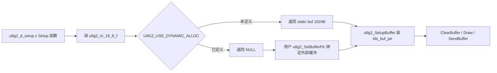

# u8g2_d_memory.c —— 静态帧缓冲分配表（生成代码）

> 对应源文件：`csrc/u8g2_d_memory.c`（共 2499 行）
> 注释分级：**B 级（文件头导读块）**，strip_equiv_check PASS
> 代码性质：由 `tools/codebuild` 自动生成，**不要手工编辑**
> 上游：单色屏图形库 u8g2（olikraus）
>
> 姊妹条目：[u8g2_d_setup.md](u8g2_d_setup.md) | [u8g2_buffer.md](u8g2_buffer.md) |
> [u8g2_setup.md](u8g2_setup.md)
> 深度文章：[Docs/01-内存与缓冲模型.md](../../../references/graphics/u8g2/Docs/01-内存与缓冲模型.md)

---

## 1. 一句话定位

为"每一种 tile 尺寸 × 每一种内存模式"提供一个 `static` 数组的分配函数。
全文件 225 个函数（75 种尺寸 × 3 种模式），**没有一个字节是动态分配的**
（除非打开 `U8G2_USE_DYNAMIC_ALLOC`）。它是 `u8g2_d_setup.c` 的配套表：
Setup 函数先来这里取 `buf` 与 `tile_buf_height`，再交给 `u8g2_SetupBuffer`。

## 2. 命名规则

```text
u8g2_m_<tile_width>_<tile_height>_<mode>

mode: 1 = 单页缓冲（tile_buf_height = 1）
      2 = 双页缓冲（tile_buf_height = 2）
      f = 全缓冲（tile_buf_height = tile_height）
```

例：`u8g2_m_16_8_f` = 16 tile 宽 × 8 tile 高 × 全缓冲 = 128x64 屏的满帧缓冲。

**注意 tile 尺寸不是像素尺寸**：128x64 屏是 16x8 tile；256x64 屏是 32x8 tile；
SSD1606 172x72 屏是 22x9 tile（172/8 向上取整）。

## 3. 函数模板

以 `u8g2_m_16_8_f` 为例（L79~L89，逐字摘录）：

```c
uint8_t *u8g2_m_16_8_f(uint8_t *page_cnt)
{
  #ifdef U8G2_USE_DYNAMIC_ALLOC
  *page_cnt = 8;
  return 0;
  #else
  static uint8_t buf[1024];
  *page_cnt = 8;
  return buf;
  #endif
}
```

三个要点：

1. **`page_cnt` 是输出参数**，返回的是 `tile_buf_height`（不是字节数）。
   全缓冲时它 = tile_height（本例 8），单页恒 1，双页恒 2。
2. **`static` 数组**：不在栈上、不占堆，链接期确定。225 个函数不会产生 225 份 RAM
   —— 只有被 `u8g2_d_setup.c` 里某个 Setup 函数引用的数组才会被链接器保留。
3. **动态分配分支返回 0（NULL）**：此时用户必须自己
   `u8g2_SetBufferPtr(&u8g2, my_buf)`（`u8g2.h:1927`），且 `my_buf` 不小于
   `tile_width × tile_buf_height × 8`。

## 4. 常见尺寸的实际字节数（已核对源码）

| 屏 | 函数 | 实际 `buf[N]` | `page_cnt` |
|---|---|---|---|
| 128x64 | `u8g2_m_16_8_1`（L57） | 128 | 1 |
| 128x64 | `u8g2_m_16_8_2`（L68） | 256 | 2 |
| 128x64 | `u8g2_m_16_8_f`（L79） | **1024** | 8 |
| 128x32 | `u8g2_m_16_4_1`（L24） | 128 | 1 |
| 128x32 | `u8g2_m_16_4_2` | 256 | 2 |
| 128x32 | `u8g2_m_16_4_f` | 512 | 4 |
| 64x48 | `u8g2_m_8_6_1` | 64 | 1 |
| 64x48 | `u8g2_m_8_6_2` | 128 | 2 |
| 64x48 | `u8g2_m_8_6_f` | 384 | 6 |
| 96x16 | `u8g2_m_12_2_1` | 96 | 1 |
| 96x16 | `u8g2_m_12_2_2` | 192 | 2 |
| 96x16 | `u8g2_m_12_2_f` | 192 | 2 |
| 256x64 | `u8g2_m_32_8_1` | 256 | 1 |
| 256x64 | `u8g2_m_32_8_f` | **2048** | 8 |
| 384x240 | `u8g2_m_48_30_f`（L2488） | **11520** | 30 |

两个"反直觉"的行：

- **128x32 的 `_1` 是 128 B，不是 64 B**。公式是 `tile_width × 8 × 1`，
  `tile_width=16` 不变，变的是 tile_height。
- **96x16 的 `_2` 与 `_f` 都是 192 B**，因为 `tile_height=2`，双页已经等于满屏。

全文件最大的是 `u8g2_m_48_30_f` 的 11520 B（384x240 屏），AVR 上绝无可能使用。

## 5. 与 `u8g2_d_setup.c` 的协作

每个 Setup 函数固定三步（以 `u8g2_Setup_ssd1306_i2c_128x64_noname_f` 为例，
`u8g2_d_setup.c:387`）：

```c
  uint8_t tile_buf_height;
  uint8_t *buf;
  u8g2_SetupDisplay(u8g2, u8x8_d_ssd1306_128x64_noname, u8x8_cad_ssd13xx_fast_i2c, byte_cb, gpio_and_delay_cb);
  buf = u8g2_m_16_8_f(&tile_buf_height);
  u8g2_SetupBuffer(u8g2, buf, tile_buf_height, u8g2_ll_hvline_vertical_top_lsb, rotation);
```

本文件只参与第二行。**`tile_buf_height` 这个 1 字节是两张生成表之间唯一的耦合**。

数据流：



## 6. 生成与裁剪机制

- **生成器**：`tools/codebuild/` 里的脚本扫描控制器列表，按 tile 尺寸去重后
  输出本文件。
- **链接裁剪**：`static uint8_t buf[N]` 只有在函数被调用时才会被引用；未被任何
  Setup 函数引用的分配函数整个被丢弃（`-ffunction-sections -Wl,--gc-sections`
  下连数组一起丢）。
- **代价**：如果同时引用 `_1`、`_2`、`_f` 三个 Setup（常见于"运行期切换模式"），
  三份数组都会进 RAM。**选一种模式就够了**，这是新手最容易犯的 RAM 浪费。

## 7. 已知坑（读码发现，未改代码）

1. **`page_cnt` 不是字节数**。把它当长度去 `memset` 只会清 1/2/8 个字节。
2. **动态分配时 `Setup` 静默成功**：返回的 `buf` 是 NULL，`u8g2_SetupBuffer`
   不做检查，第一次 `ClearBuffer` 才崩。必须在 Setup 后立刻
   `u8g2_SetBufferPtr`。
3. **手改本文件会被下次生成覆盖**。要改尺寸只能改生成器或改控制器描述。
4. **225 个函数全部有外部链接**（非 static），命名冲突风险为零（名字唯一），
   但会占符号表空间。

## 8. 互链

- 谁调用这些函数：[u8g2_d_setup.md](u8g2_d_setup.md)
- 缓冲如何被使用：[u8g2_buffer.md](u8g2_buffer.md)
- 装配细节：[u8g2_setup.md](u8g2_setup.md)
- RAM 账本：[Docs/01-内存与缓冲模型.md](../../../references/graphics/u8g2/Docs/01-内存与缓冲模型.md)
