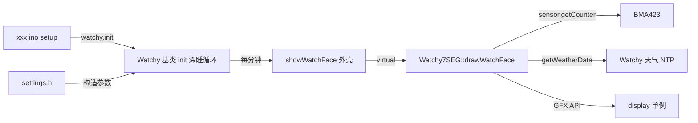

# examples/ 导读 —— 官方表盘样例（C 级，不做源码注释）

> 对应源文件：`examples/WatchFaces/`（8 个样例目录，共约 50 个文件；
> 本条目按任务书要求仅做导读，C 级不注释任何样例源码）
> 关联 Docs：[01-库框架与生命周期](../../../references/firmware/Watchy/Docs/01-库框架与生命周期.md)
> 关联 KB：[watchy_h.md](watchy_h.md)（继承 API）

---

## 1. 样例的价值：表盘开发的 8 个模板

每个样例目录结构一致：

| 文件 | 角色 |
|---|---|
| `<名字>.ino` | Arduino 入口：10 行左右，`WatchyXXX watchy(settings); watchy.init();` |
| `Watchy_<名字>.h/.cpp` | 继承 `Watchy` 的表盘类，核心是 override `drawWatchFace()` |
| `settings.h` | weatherData/watchySettings 的填法模板（42 行，8 个样例基本相同） |
| `*.h`（字体/图标/位图） | 资产文件（字体数组、GIMP 导出的图像数组） |
| `*.bin` | 预编译固件（可直接 OTA/烧录试玩） |

## 2. 8 个样例一览

| 样例 | 核心文件行数 | 技术看点 | 适合学什么 |
|---|---|---|---|
| **Basic** | 10 行 | 无自定义类，直接用基类默认表盘 | 最小可运行骨架 |
| **7_SEG** | Watchy_7_SEG.cpp 157 行 | DSEG7 字体 + 图标 + 天气 + 步数 + 电量分段条 | 全功能表盘的标准答案 |
| **DOS** | 30 行 | Px437 IBM BIOS 字体，纯文本"假终端" | setFont + println 排版 |
| **MacPaint** | 18 行 | 整屏背景位图 + 数字位图拼贴 | drawBitmap 拼装 UI |
| **Mario** | 64 行 | 场景位图 + 位图数字 + 金币/管道装饰 | 位图坐标布局 |
| **Pokemon** | 17 行 | 全屏精灵图 + 小字体时间 | 最简单"贴图"流 |
| **Tetris** | 15 行 | 背景 + 方块数字位图 | 同上 |
| **StarryHorizon** | 151 行 | 900 颗星 PROGMEM 随机场 + 3D 投影行星 | 大量数据 + 数学绘制（作者 Dan Delany） |

## 3. 每分钟会跑什么：以 7_SEG 为例

`drawWatchFace()`（Watchy_7_SEG.cpp:11-28）每分钟被 `showWatchFace` 调用一次，
内部依次：背景填充 → drawTime（DSEG7 大字）→ drawDate（星期/月/日/年，
含 Wday 文本右对齐）→ drawSteps（**0 点自动 resetStepCounter**，L78-87）→
drawWeather（调 `getWeatherData()`，内部 30 分钟节流；天气码→图标映射
L111-157）→ drawBattery（电压分 4 档画电量条，L88-109）→ WiFi/BLE 图标。

这个样例就是库全部 API 的活文档：`currentTime`、`sensor`、`getWeatherData()`、
`getBatteryVoltage()`、`WIFI_CONFIGURED/BLE_CONFIGURED` 全用上了。

## 4. settings.h 模板（各样例基本一致）

| 配置 | 样例值 | 说明 |
|---|---|---|
| `CITY_ID` | "5128581"（纽约） | OpenWeatherMap 城市ID；注释掉则用 LAT/LON |
| `OPENWEATHERMAP_URL` | http 模板（http 非 https） | 占位符 {cityID}/{lat}/{lon}/{lang}/{units}/{apiKey} |
| `OPENWEATHERMAP_APIKEY` | "YOUR_OPENWEATHER_API_KEY" | **要换自己的 key** |
| `TEMP_UNIT/TEMP_LANG` | metric/en | 单位与语言 |
| `WEATHER_UPDATE_INTERVAL` | 30（分钟） | 必须 >5 |
| `NTP_SERVER/GMT_OFFSET_SEC` | pool.ntp.org / 3600*-5 | 时区样例是纽约，**国内改 3600*8** |
| `vibrateOClock` | true | 整点震动 |

## 5. 从哪个入手写自己的表盘

1. 复制 `Basic/` 改名 → 最快见效；
2. 需要天气/步数/电量 → 抄 `7_SEG/` 的对应 draw* 函数；
3. 想画图标/背景 → 用 GIMP 导出 XBM/位图数组（MacPaint/Tetris 是范例）；
4. 记住三条铁律（原理见 Docs/01）：
   - 只画，不调 `display.display()`（外壳统一送显）；
   - 每分钟最多跑一次 drawWatchFace，别在里面放循环；
   - 想做秒级动画 = 与深睡架构冲突，墨水屏也不适合（残影+寿命）。

## 6. 与库的关系（数据流）

## 7. 注意

- 样例按 C 级处理（演示样例），**本次未添加任何源码注释**；
- 各样例的 `.bin` 是旧版库编译产物，仅试玩用，别当最新功能参考；
- `StarryHorizon` 的 stars.h 生成函数（initStars）是"离线生成 PROGMEM
  数据"的好范例：串口打印结果手工贴回头文件。
- 逐文件深读入口：KB 其余 13 条（src/ 各文件）与 Docs 6 篇。
