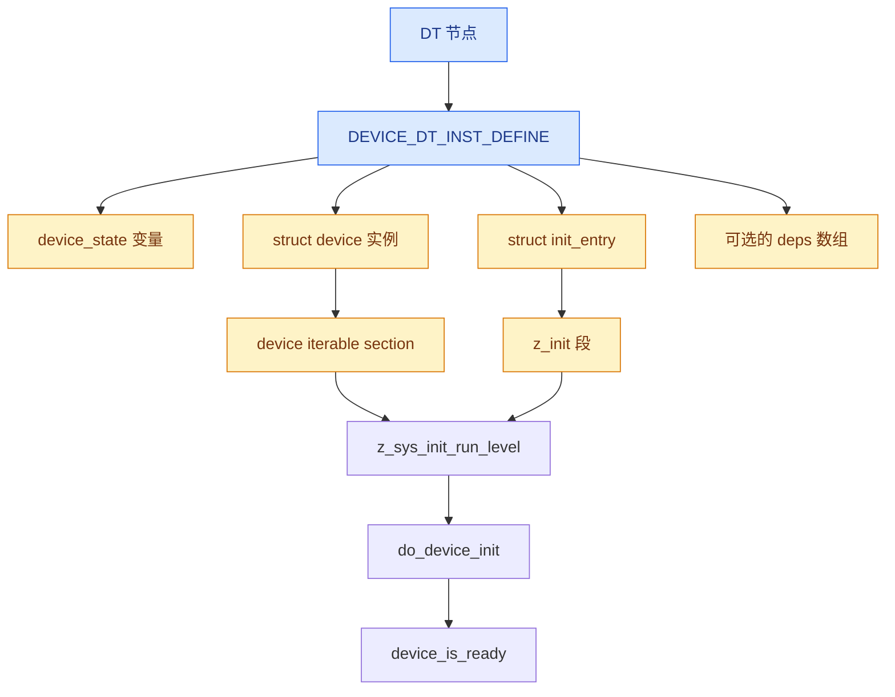
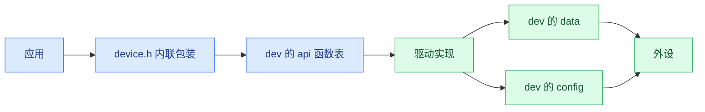

# device —— 设备模型

> 对应源文件：`kernel/device.c`（共 277 行）、
> `include/zephyr/device.h`（共 1501 行）
>
> 关联文件：`kernel/init.c`（`z_sys_init_run_level`）、
> `include/zephyr/init.h`（`struct init_entry`）、
> `drivers/gpio/gpio_emul.c`（完整驱动样例）。

一句话职责：**把 devicetree 节点 + 驱动代码变成 ROM 里的
`struct device`，并在启动时按 level/prio 调用驱动的 init 函数**。

---

## 1. `struct device` 与 `device_state`

### 1.1 `struct device`

`device.h:543-557`（后续字段见表格）：

```c
struct device {
	/** Name of the device instance */
	const char *name;
	/** Address of device instance config information */
	const void *config;
	/** Address of the API structure exposed by the device instance */
	const void *api;
	/** Address of the common device state */
	struct device_state *state;
	/** Address of the device instance private data */
	void *data;
	/** Device operations */
	struct device_ops ops;
	/** Device flags */
	device_flags_t flags;
```

`deps`（`CONFIG_DEVICE_DEPS`）、`pm`（`CONFIG_PM_DEVICE`）、
`dt_meta`（`CONFIG_DEVICE_DT_METADATA`）是三个可选字段。

| 字段 | 位置 | 含义 |
|---|---|---|
| `name` | 545 | `DEVICE_DT_NAME(node)` 或 `DEVICE_DEFINE` 的名字 |
| `config` | 547 | 指向 `*_config` 常量 |
| `api` | 549 | 指向 `*_driver_api` 函数表 |
| `state` | 551 | RAM 中的 `device_state` |
| `data` | 553 | 指向 `*_data` 可变结构 |
| `ops` | 555 | `init`/`deinit` 函数指针 |
| `flags` | 557 | `DEVICE_FLAG_INIT_DEFERRED` |
| `deps` | 567 | 依赖句柄数组（`CONFIG_DEVICE_DEPS`） |
| `pm` | 574-581 | 电源管理资源 |
| `dt_meta` | 588 | DT 元数据（nodelabel 等） |

### 1.2 `device_state`

`device.h:488-502`：

```c
struct device_state {
	/**
	 * Device initialization return code (positive errno value).
	 *
	 * Device initialization functions return a negative errno code if they
	 * fail. In Zephyr, errno values do not exceed 255, so we can store the
	 * positive result value in a uint8_t type.
	 */
	uint8_t init_res;

	/** Indicates the device initialization function has been
	 * invoked.
	 */
	bool initialized : 1;
};
```

`init_res` 存正 errno，`initialized` 在 init **失败时也为 true**。
所以"就绪" = `initialized && init_res == 0`。

### 1.3 大小

| 平台 | `struct device` | `device_state` |
|---|---|---|
| 32 位 | ~40 B | 2 B（对齐 4 B） |
| 64 位 | ~80 B | 2 B（对齐 8 B） |

---

## 2. 函数清单

### 2.1 `kernel/device.c`

| 函数 | 行号 | 作用 |
|---|---|---|
| `do_device_init` | 18 | 调 `ops.init`，记录错误码 |
| `z_impl_device_init` | 63 | 运行期初始化（延迟设备） |
| `z_impl_device_get_binding` | 83 | 按名字查找 |
| `z_impl_device_get_by_dt_nodelabel` | 126 | 按 DT nodelabel 查找 |
| `z_device_get_all_static` | 176 | 取设备表 |
| `z_impl_device_is_ready` | 186 | 判断就绪 |
| `z_impl_device_deinit` | 199 | 反初始化 |
| `device_visitor` | 238 | 依赖遍历辅助 |
| `device_required_foreach` | 257 | 遍历 required 依赖 |
| `device_supported_foreach` | 267 | 遍历 supported 依赖 |

### 2.2 `include/zephyr/device.h`（宏）

| 宏 | 行号 | 作用 |
|---|---|---|
| `DEVICE_DEINIT_DEFINE` | 182 | 带 deinit 的软件设备 |
| `DEVICE_DEFINE` | 194 | 软件设备 |
| `DEVICE_DT_NAME` | 210 | 从节点取名字 |
| `DEVICE_DT_DEINIT_DEFINE` | 249 | 带 deinit 的 DT 设备 |
| `DEVICE_DT_DEFINE` | 265 | DT 设备 |
| `DEVICE_DT_INST_DEINIT_DEFINE` | 278 | 按实例号 |
| `DEVICE_DT_INST_DEFINE` | 289 | 按实例号（最常用） |
| `DEVICE_DT_GET` | 323 | 编译期取设备指针 |
| `DEVICE_DT_INST_GET` | 346 | 按实例号取指针 |
| `DEVICE_DT_GET_ANY` | 376 | 按 compatible 取任意一个 |
| `device_handle_get` | 600 | 指针 → 句柄 |
| `device_from_handle` | 623 | 句柄 → 指针 |
| `Z_DEVICE_SECTION_NAME` | 1294 | section 名 |
| `Z_DEVICE_BASE_DEFINE` | 1316 | 定义 `struct device` |
| `Z_DEVICE_CHECK_INIT_LEVEL` | 1331 | 限制 level |
| `Z_DEVICE_INIT_ENTRY_DEFINE` | 1346 | 定义 `init_entry` |
| `Z_DEVICE_DEFINE` | 1378 | 总装 |
| `DEVICE_API` | 1432 | 定义 API 表 |

---

## 3. 逐字摘录

### 3.1 `do_device_init`

`device.c:18-61`：

```c
int do_device_init(const struct device *dev)
{
	int rc = 0;

	if (dev->ops.init != NULL) {
		rc = dev->ops.init(dev);
		/* If initialization failed, record in dev->state->init_res
		 * the POSITIVE value of the resulting errno
		 */
		if (rc != 0) {
			/* device's init function should return:
			 *   0 on success
			 *   a negative value on failure (-errno)
			 * errno value maps to an uint8_t range as of now.
			 */
			__ASSERT(rc >= -UINT8_MAX && rc < 0, "device %s init: invalid error (%d)",
				 dev->name, rc);

			if (rc < 0) {
				rc = -rc;
			}
			/* handle error value overflow in production
			 * this is likely a bug in the device's init function. Signals it
			 */
			if (rc > UINT8_MAX) {
				rc = UINT8_MAX;
			}
			dev->state->init_res = rc;
		}
	}

	/* device initialization has been invoked */
	dev->state->initialized = true;

	if (rc == 0) {
		/* Run automatic device runtime enablement */
		(void)pm_device_runtime_auto_enable(dev);
	}

	/* here, the value of rc is either 0 or +errno
	 * flip the sign to return a negative value on failure as expected
	 */
	return -rc;
}
```

### 3.2 `device_is_ready`

`device.c:186-197`：

```c
bool z_impl_device_is_ready(const struct device *dev)
{
	/*
	 * if an invalid device pointer is passed as argument, this call
	 * reports the `device` as not ready for usage.
	 */
	if (dev == NULL) {
		return false;
	}

	return dev->state->initialized && (dev->state->init_res == 0U);
}
```

### 3.3 `DEVICE_DT_DEFINE` 展开

`device.h:249-257`：

```c
#define DEVICE_DT_DEINIT_DEFINE(node_id, init_fn, deinit_fn, pm, data, config, \
				level, prio, api, ...)                         \
	Z_DEVICE_STATE_DEFINE(Z_DEVICE_DT_DEV_ID(node_id));                    \
	Z_DEVICE_DEFINE(node_id, Z_DEVICE_DT_DEV_ID(node_id),                  \
			DEVICE_DT_NAME(node_id), init_fn, deinit_fn,           \
			Z_DEVICE_DT_FLAGS(node_id), pm, data, config, level,   \
			prio, api,                                             \
			&Z_DEVICE_STATE_NAME(Z_DEVICE_DT_DEV_ID(node_id)),     \
			__VA_ARGS__)
```

`device.h:1378-1397`：

```c
#define Z_DEVICE_DEFINE(node_id, dev_id, name, init_fn, deinit_fn, flags, pm,   \
			data, config, level, prio, api, state, ...)             \
	Z_DEVICE_NAME_CHECK(name);                                              \
                                                                                \
	IF_ENABLED(CONFIG_DEVICE_DEPS,                                          \
		   (Z_DEVICE_DEPS_DEFINE(node_id, dev_id, __VA_ARGS__);))       \
                                                                                \
	IF_ENABLED(CONFIG_DEVICE_DT_METADATA,                                   \
		   (IF_ENABLED(DT_NODE_EXISTS(node_id),                         \
			      (Z_DEVICE_DT_METADATA_DEFINE(node_id, dev_id);))))\
                                                                                \
	Z_DEVICE_BASE_DEFINE(node_id, dev_id, name, init_fn, deinit_fn, flags,  \
			     pm, data, config, level, prio, api, state,         \
			     Z_DEVICE_DEPS_NAME(dev_id));                       \
                                                                                \
	Z_DEVICE_INIT_ENTRY_DEFINE(node_id, dev_id, level, prio);               \
                                                                                \
	IF_ENABLED(CONFIG_LLEXT,                                                \
		   (IF_ENABLED(DT_NODE_EXISTS(node_id),                         \
				(Z_DEVICE_EXPORT(node_id);))))
```

### 3.4 init entry

`device.h:1346-1354`：

```c
#define Z_DEVICE_INIT_ENTRY_DEFINE(node_id, dev_id, level, prio)                                   \
	Z_DEVICE_CHECK_INIT_LEVEL(level)                                                           \
                                                                                                   \
	static const Z_DECL_ALIGN(struct init_entry) __used __noasan Z_INIT_ENTRY_SECTION(         \
		level, prio, Z_DEVICE_INIT_SUB_PRIO(node_id))                                      \
		Z_INIT_ENTRY_NAME(DEVICE_NAME_GET(dev_id)) = {                                     \
			.init_fn = NULL,                                                           \
			.dev = (const struct device *)&DEVICE_NAME_GET(dev_id),                    \
		}
```

### 3.5 按名字查找

`device.c:83-100`：

```c
const struct device *z_impl_device_get_binding(const char *name)
{
	/* A null string identifies no device.  So does an empty
	 * string.
	 */
	if ((name == NULL) || (name[0] == '\0')) {
		return NULL;
	}

	/* Return NULL if the device matching 'name' is not ready. */
	STRUCT_SECTION_FOREACH(device, dev) {
		if ((dev->name == name) || (strcmp(name, dev->name) == 0)) {
			return z_impl_device_is_ready(dev) ? dev : NULL;
		}
	}

	return NULL;
}
```

### 3.6 设备句柄

`device.h:600-613`：

```c
static inline device_handle_t device_handle_get(const struct device *dev)
{
	device_handle_t ret = DEVICE_HANDLE_NULL;
	STRUCT_SECTION_START_EXTERN(device);

	/* TODO: If/when devices can be constructed that are not part of the
	 * fixed sequence we'll need another solution.
	 */
	if (dev != NULL) {
		ret = 1 + (device_handle_t)(dev - STRUCT_SECTION_START(device));
	}

	return ret;
}
```

---

## 4. 对象生成图





---

## 5. 量化

### 5.1 单设备开销（32 位）

| 项目 | ROM | RAM |
|---|---|---|
| `struct device` | 40 B | 0 |
| `device_state` | 0 | 4 B |
| `init_entry` | 8 B | 0 |
| config 结构 | 视驱动 | 0 |
| data 结构 | 0 | 视驱动 |
| API 表 | 视驱动（约 10 个指针 = 40 B） | 0 |

### 5.2 初始化顺序

```
(level, prio, sub_prio)
level: PRE_KERNEL_1(1) < PRE_KERNEL_2(2) < POST_KERNEL(3)
```

`sub_prio` 由 `Z_DEVICE_INIT_SUB_PRIO(node_id)` 从 DT 依赖计算，
保证被依赖的设备先初始化。

---

## 6. 陷阱与读码建议

1. **`device_is_ready()` 无法区分"未初始化"与"初始化失败"**。
2. **`DEVICE_DT_GET()` 是链接期解析**。节点没有对应设备时
   报 `undefined reference to __device_dts_ord_N`。
3. **`prio` 不能是表达式**。section 名需要编译期字符串。
4. **设备只能用 PRE_KERNEL_1/2/POST_KERNEL**，
   `Z_DEVICE_CHECK_INIT_LEVEL()` 会编译期报错。
5. **`DEVICE_FLAG_INIT_DEFERRED` 的设备启动时被跳过**，
   必须运行期 `device_init()`。
6. **`device_get_binding()` 只返回 ready 的设备**；
   想拿"存在但没 ready"的指针只能用 `DEVICE_DT_GET()`。
7. **`dev->api` 可能为 NULL**，所有包装都要判空。

**读码建议**：先读 `device.h` 的 4 个宏（`DEVICE_DT_DEFINE` →
`Z_DEVICE_DEFINE` → `Z_DEVICE_BASE_DEFINE` + `Z_DEVICE_INIT_ENTRY_DEFINE`），
再读 `kernel/device.c` 的 5 个运行时函数，最后看一个真实驱动
（`gpio_emul.c`）如何填 API 表。

---

## 7. 相关条目

- `sys_init.md`：`init_entry` 与 level
- `z_cstart.md`：`z_sys_init_run_level` 的调用点
- Docs：`../../../references/rtos/Zephyr/Docs/05-设备驱动模型.md`
