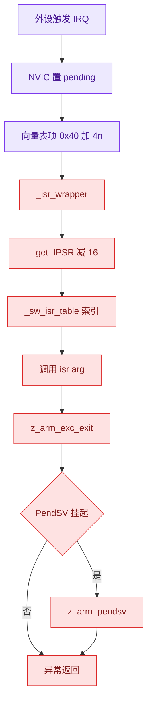

# irq —— 中断入口与软中断表

> 对应源文件：
> - `arch/arm/core/cortex_m/isr_wrapper.c`（共 98 行）
> - `arch/arm/core/cortex_m/irq_manage.c`（共 304 行）
> - `arch/arm/core/cortex_m/vector_table.S`（共 96 行）
> - `include/zephyr/sw_isr_table.h`（共 317 行）
> - `kernel/irq_offload.c`（共 23 行）
>
> 路径说明：仓库里**没有** `kernel/irq.c`。Zephyr 的中断入口是
> 架构相关的：Cortex-M 在 `arch/arm/core/cortex_m/`，通用 API 在
> `include/zephyr/irq.h`，软件中断表在 `include/zephyr/sw_isr_table.h`。
> `kernel/irq_offload.c` 只是"在 ISR 上下文执行函数"的小工具。

一句话职责：**把硬件异常向量分派到用户 ISR**，并提供
`IRQ_CONNECT`/`IRQ_DIRECT_CONNECT` 的链接期注册机制。

---

## 1. 向量表与异常号

### 1.1 前 16 个系统异常

`vector_table.S:40-96`：

```asm
    .word z_main_stack + CONFIG_MAIN_STACK_SIZE

    .word z_arm_reset
    .word z_arm_nmi

    .word z_arm_hard_fault
#if defined(CONFIG_ARMV6_M_ARMV8_M_BASELINE)
    .word 0
    ...
#elif defined(CONFIG_ARMV7_M_ARMV8_M_MAINLINE)
    .word z_arm_mpu_fault
    .word z_arm_bus_fault
    .word z_arm_usage_fault
...
    .word z_arm_svc
    .word z_arm_debug_monitor
...
```

| 异常号 | 向量 | Zephyr 符号 |
|---|---|---|
| 0 | 初始 MSP | `z_main_stack + CONFIG_MAIN_STACK_SIZE` |
| 1 | Reset | `z_arm_reset` |
| 2 | NMI | `z_arm_nmi` |
| 3 | HardFault | `z_arm_hard_fault` |
| 4 | MemManage | `z_arm_mpu_fault` |
| 5 | BusFault | `z_arm_bus_fault` |
| 6 | UsageFault | `z_arm_usage_fault` |
| 11 | SVCall | `z_arm_svc` |
| 12 | DebugMonitor | `z_arm_debug_monitor` |
| 14 | PendSV | `z_arm_pendsv` 或 `z_arm_exc_spurious` |
| 15 | SysTick | `sys_clock_isr` |
| 16+ | 外部 IRQ | `_isr_wrapper` |

前 16 项 = 64 B。外部 IRQ 从 `0x40` 开始，每项 4 B。

### 1.2 向量表大小

```
64 B + CONFIG_NUM_IRQS × 4 B
```

`CONFIG_NUM_IRQS` 由 SoC 的 devicetree/Kconfig 给出，
常见值 32/64/96/128。128 个 IRQ 的向量表 = 64 + 512 = **576 B**。

---

## 2. 软中断表

### 2.1 表项

`sw_isr_table.h:34-42`：

```c
/*
 * Note the order: arg first, then ISR. This allows a table entry to be
 * loaded arg -> r0, isr -> r3 in _isr_wrapper with one ldmia instruction,
 * on ARM Cortex-M (Thumb2).
 */
struct _isr_table_entry {
	const void *arg;
	void (*isr)(const void *);
};
```

32 位下 8 B/项。

### 2.2 表本身

`sw_isr_table.h:44-55`：

```c
#if defined(CONFIG_GEN_SW_ISR_TABLE_ARRAY)
/* The software ISR table itself, an array of these structures indexed by the
 * irq line
 */
extern
#ifndef CONFIG_DYNAMIC_INTERRUPTS
	const
#endif /* CONFIG_DYNAMIC_INTERRUPTS */
	struct _isr_table_entry _sw_isr_table[];
#elif defined(CONFIG_GEN_SW_ISR_TABLE_SWITCH)
extern void __sw_isr_table get_isr_entry(int irq_number, struct _isr_table_entry *entry);
#endif /* CONFIG_GEN_SW_ISR_TABLE_ARRAY */
```

两种模式：

| 模式 | 表位置 | 运行期可改 | 开销 |
|---|---|---|---|
| `ARRAY` | ROM（静态）/ RAM（动态） | 动态时可改 | 一次数组索引 |
| `SWITCH` | 由 `get_isr_entry()` 返回 | 可以 | 一次函数调用/查表 |

### 2.3 注册记录

`sw_isr_table.h:147-156`：

```c
struct _isr_list {
	/** IRQ line number */
	int32_t irq;
	/** Flags for this IRQ, see ISR_FLAG_* definitions */
	int32_t flags;
	/** ISR to call */
	void *func;
	/** Parameter for non-direct IRQs */
	const void *param;
};
```

`Z_ISR_DECLARE` 把它放进 `.intList` 段：

```c
#define Z_ISR_DECLARE(irq, flags, func, param) \
	static Z_DECL_ALIGN(struct _isr_list) Z_GENERIC_SECTION(.intList) \
		__used _MK_ISR_NAME(func, __COUNTER__) = \
			{irq, flags, (void *)&func, (const void *)param}
```

（`sw_isr_table.h:286-289`）

---

## 3. 运行期分派

### 3.1 `_isr_wrapper`

`isr_wrapper.c:192-221`（PM 处理之后的分派部分）：

```c
#if defined(CONFIG_ARM_CUSTOM_INTERRUPT_CONTROLLER)
	int32_t irq_number = z_soc_irq_get_active();
#else
	int32_t irq_number = __get_IPSR();
#endif
	/* _sw_isr_table does not map the core system exceptions,
	 * which take first 16 interrupt numbers, only the external
	 * interrupts.
	 */
	irq_number -= 16;

#if defined(CONFIG_GEN_SW_ISR_TABLE_ARRAY)
	const struct _isr_table_entry *entry = &_sw_isr_table[irq_number];
	(entry->isr)(entry->arg);
#elif defined(CONFIG_GEN_SW_ISR_TABLE_SWITCH)
	struct _isr_table_entry entry;

	get_isr_entry(irq_number, &entry);
	(entry.isr)(entry.arg);
#endif /* CONFIG_GEN_SW_ISR_TABLE_ARRAY */

#if defined(CONFIG_ARM_CUSTOM_INTERRUPT_CONTROLLER)
	z_soc_irq_eoi(irq_number);
#endif

#ifdef CONFIG_TRACING_ISR
	sys_trace_isr_exit();
#endif /* CONFIG_TRACING_ISR */

	z_arm_exc_exit();
}
```

### 3.2 `IRQ_CONNECT` 展开

`include/zephyr/arch/arm/irq.h:180-187`：

```c
#define ARCH_IRQ_CONNECT(irq_p, priority_p, isr_p, isr_param_p, flags_p) \
{ \
	BUILD_ASSERT(!(flags_p & IRQ_ZERO_LATENCY), \
			"ZLI interrupts must be registered using IRQ_DIRECT_CONNECT()"); \
	_CHECK_PRIO(priority_p, flags_p) \
	Z_ISR_DECLARE(irq_p, 0, isr_p, isr_param_p); \
	z_arm_irq_priority_set(irq_p, priority_p, flags_p); \
}
```

两部分：

- `Z_ISR_DECLARE`：**链接期**写 `.intList`，生成 `_sw_isr_table`；
- `z_arm_irq_priority_set`：**运行期**写 NVIC 优先级寄存器。

### 3.3 动态安装

`irq_manage.c:266-273`：

```c
int arch_irq_connect_dynamic(unsigned int irq, unsigned int priority,
			     void (*routine)(const void *parameter), const void *parameter,
			     uint32_t flags)
{
	z_isr_install(irq, routine, parameter);
	z_arm_irq_priority_set(irq, priority, flags);
	return irq;
}
```

`CONFIG_DYNAMIC_INTERRUPTS=y` 时可用；`_sw_isr_table` 必须在 RAM。

### 3.4 直接中断

`include/zephyr/arch/arm/irq.h:241-249`：

```c
#define ARCH_ISR_DIRECT_DECLARE(name) \
	static inline int name##_body(void); \
	ARCH_ISR_DIAG_OFF \
	__attribute__ ((interrupt ("IRQ"))) void name(void) \
	{ \
		int check_reschedule; \
		ISR_DIRECT_HEADER(); \
		check_reschedule = name##_body(); \
		ISR_DIRECT_FOOTER(check_reschedule); \
```

`IRQ_DIRECT_CONNECT`（`arch/arm/irq.h:189-196`）：

```c
#define ARCH_IRQ_DIRECT_CONNECT(irq_p, priority_p, isr_p, flags_p) \
{ \
	BUILD_ASSERT(IS_ENABLED(CONFIG_ZERO_LATENCY_IRQS) || !(flags_p & IRQ_ZERO_LATENCY), \
			"ZLI interrupt registered but feature is disabled"); \
	_CHECK_PRIO(priority_p, flags_p) \
	Z_ISR_DECLARE_DIRECT(irq_p, ISR_FLAG_DIRECT, isr_p); \
	z_arm_irq_priority_set(irq_p, priority_p, flags_p); \
}
```

direct ISR **绕过 `_isr_wrapper`**，直接进向量表。
返回值 0 = 不做调度决策，非 0 = 调 `z_arm_int_exit()`。

### 3.5 `irq_offload`

`kernel/irq_offload.c:14-23`：

```c
void irq_offload(irq_offload_routine_t routine, const void *parameter)
{
#ifdef CONFIG_IRQ_OFFLOAD_NESTED
	arch_irq_offload(routine, parameter);
#else
	k_sem_take(&offload_sem, K_FOREVER);
	arch_irq_offload(routine, parameter);
	k_sem_give(&offload_sem);
#endif /* CONFIG_IRQ_OFFLOAD_NESTED */
}
```

`CONFIG_IRQ_OFFLOAD_NESTED=n` 时用信号量串行化；
在 ISR 里调用会因 `k_sem_take(K_FOREVER)` 触发
`z_pend_curr()` 的 panic。

---

## 4. 分派路径图




---

## 5. 函数清单

### 5.1 `irq_manage.c`

| 函数 | 行号 | 作用 |
|---|---|---|
| `arm_irq_enable` | 56 | `NVIC_EnableIRQ` |
| `arm_irq_disable` | 61 | `NVIC_DisableIRQ` |
| `arm_irq_is_enabled` | 66 | 读 `NVIC->ISER` |
| `arm_irq_clear_pending` | 72 | 清 pending |
| `arm_irq_set_pending` | 79 | 置 pending |
| `arm_irq_is_pending` | 86 | 读 pending |
| `arm_irq_priority_set` | 103 | 设置优先级（含 ZLI 偏移） |
| `z_irq_spurious` | 148 | 默认 ISR，触发 fatal |
| `_arch_isr_direct_pm` | 156 | direct ISR 的 PM 恢复 |
| `irq_target_state_set` | 192 | ARMv8-M 安全态路由 |
| `irq_target_state_is_secure` | 226 | 查询安全态 |
| `irq_target_state_set_all_non_secure` | 244 | 全部路由到非安全态 |
| `arch_irq_connect_dynamic` | 266 | 动态注册 |
| `z_arm_irq_dynamic_direct_isr_dispatch` | 277 | 动态 direct 分派 |

### 5.2 `irq_offload.c`

| 函数 | 行号 | 作用 |
|---|---|---|
| `irq_offload` | 14 | 在 ISR 上下文执行函数 |

---

## 6. 量化

### 6.1 中断延迟（Cortex-M3/M4，72 MHz）

| 阶段 | 周期 |
|---|---|
| 硬件异常进入（压 8 寄存器） | 12 |
| `_isr_wrapper` 取 IPSR + 减 16 | ~6 |
| 查表 + 间接调用 | ~8 |
| 用户 ISR 开始执行 | **~26（0.36 µs）** |
| `z_arm_exc_exit` | 10~30 |
| 硬件异常返回 | 12 |

### 6.2 内存

| 项目 | 大小 |
|---|---|
| 向量表系统异常部分 | 64 B |
| 向量表外部 IRQ 部分 | `CONFIG_NUM_IRQS × 4` B |
| `_sw_isr_table` | `CONFIG_NUM_IRQS × 8` B |
| `.intList`（仅构建期） | `IRQ 数 × 16` B |

`CONFIG_NUM_IRQS=96` 时：向量表 64+384=448 B，
软中断表 768 B，合计 **1216 B**（静态模式，ROM）。

---

## 7. 陷阱与读码建议

1. **`IRQ_CONNECT` 的参数是外部 IRQ 号**（0 对应向量表第 16 项），
   不是异常号。给 SysTick 写 `IRQ_CONNECT(15, ...)` 是错的。
2. **`_sw_isr_table` 不包含系统异常**（`irq_number -= 16`）。
3. **ZLI 中断必须用 `IRQ_DIRECT_CONNECT`**，
   `ARCH_IRQ_CONNECT` 里有 `BUILD_ASSERT`。
4. **direct ISR 返回非 0 才做调度决策**；返回 2 也会被当 true。
5. **`irq_offload()` 在 ISR 里可能 panic**（`IRQ_OFFLOAD_NESTED=n`）。
6. **`arm_irq_priority_set()` 会加 `_IRQ_PRIO_OFFSET`**，
   内核保留最高几级给 PendSV/SysTick；用户传入的 prio 不是
   最终写进 NVIC 的值。

**读码建议**：先读 `vector_table.S` 的 96 行（就是一张表），
再读 `isr_wrapper.c` 的 98 行（4 步分派），最后读
`irq_manage.c` 的 NVIC 封装与 `ISR_DIRECT_DECLARE`。

## 8. 相关条目

- `z_cstart.md`：`arch_kernel_init` 里的中断初始化
- `device.md`：驱动如何在 init 里 `IRQ_CONNECT`
- Docs：`../../../references/rtos/Zephyr/Docs/06-中断与异常.md`
