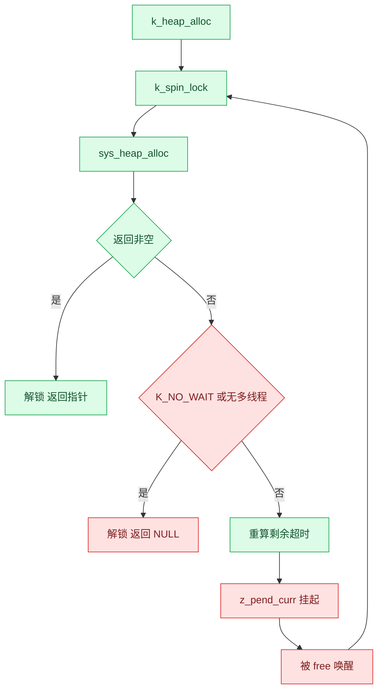

# k_heap —— 可阻塞的堆分配

> 对应源文件：`kernel/kheap.c`（共 193 行）、`kernel/mempool.c`（共 226 行）
>
> 路径说明：仓库里**没有** `kernel/heap.c` 或 `kernel/mempool_heap.c`。
> `k_heap` 的实现位于 `kernel/kheap.c`；`kernel/mempool.c` 是
> `k_malloc/k_free/k_calloc/k_realloc` 的兼容层（旧 `k_mem_pool` API 的
> 薄封装），底层仍走系统 `k_heap`。
>
> 关联文件：`include/zephyr/kernel.h`（`struct k_heap`，第 6295 行）、
> `include/zephyr/sys/sys_heap.h`（`sys_heap` 实现，位于 `lib/os/`）。

一句话职责：**在 `sys_heap` 之上增加自旋锁、等待队列与超时**，
让"堆暂时没有空间"变成"线程可阻塞等待"而不是返回 NULL。

---

## 1. 对象结构

`include/zephyr/kernel.h:6295-6306`：

```c
struct k_heap {
	struct sys_heap heap;
	_wait_q_t wait_q;
	struct k_spinlock lock;
};
```

| 字段 | 含义 |
|---|---|
| `heap` | `sys_heap`：分离空闲链表 + 块元数据 |
| `wait_q` | 分配失败时阻塞的线程 |
| `lock` | 保护 `sys_heap` 与等待队列 |

32 位下 `k_heap` 约 **24 B**（`sys_heap` 内部约 16 B +
`wait_q` 8 B + 锁 0/4 B）。

静态堆宏：

`mempool.c:86-87`：

```c
K_HEAP_DEFINE(_system_heap, Z_HEAP_MIN_SIZE_FOR(K_HEAP_MEM_POOL_SIZE));
#define _SYSTEM_HEAP (&_system_heap)
```

`K_HEAP_DEFINE` 会定义一个 `k_heap` 结构 + 一块静态内存区，
并把堆对象放进 `k_heap` iterable section，供 `statics_init()`
在 `PRE_KERNEL_1` 统一初始化。

---

## 2. 函数清单

### 2.1 `kernel/kheap.c`

| 函数 | 行号 | 作用 |
|---|---|---|
| `k_heap_array_get` | 15 | 取静态堆数组与数量 |
| `k_heap_init` | 26 | 初始化 `sys_heap` + wait_q |
| `statics_init` | 35 | 初始化所有静态堆 |
| `z_heap_alloc_helper` | 53 | 分配/阻塞/重试的公共循环 |
| `k_heap_alloc` | 93 | 无对齐分配 |
| `k_heap_aligned_alloc` | 105 | 对齐分配 |
| `k_heap_calloc` | 131 | 分配并清零 |
| `k_heap_realloc` | 150 | 重新分配 |
| `k_heap_free` | 181 | 释放并唤醒等待者 |

### 2.2 `kernel/mempool.c`

| 函数 | 行号 | 作用 |
|---|---|---|
| `z_alloc_helper` | 14 | 在块头记录所属 heap |
| `k_free` | 58 | 从块头取 heap 并释放 |
| `k_aligned_alloc` | 94 | 系统堆对齐分配 |
| `k_malloc` | 105 | 系统堆分配 |
| `k_calloc` | 116 | 系统堆清零分配 |
| `k_realloc` | 139 | 系统堆重分配 |
| `k_thread_system_pool_assign` | 181 | 把系统堆绑到线程 |
| `z_thread_alloc_helper` | 189 | 按当前线程选堆 |
| `z_thread_aligned_alloc` | 210 | 线程堆对齐分配 |
| `z_thread_malloc` | 215 | 线程堆分配 |

---

## 3. 逐字摘录

### 3.1 初始化

`kheap.c:26-49`：

```c
void k_heap_init(struct k_heap *heap, void *mem, size_t bytes)
{
	z_waitq_init(&heap->wait_q);
	heap->lock = (struct k_spinlock) {};
	sys_heap_init(&heap->heap, mem, bytes);

	SYS_PORT_TRACING_OBJ_INIT(k_heap, heap);
}

static int statics_init(void)
{
	STRUCT_SECTION_FOREACH(k_heap, heap) {
		k_heap_init(heap, heap->heap.init_mem, heap->heap.init_bytes);
	}
	return 0;
}

/*
 * Static heap init must stay a PRE_KERNEL_1 SYS_INIT: the heap KASAN shadow is
 * registered at (PRE_KERNEL_1, 0) via K_HEAP_KASAN_ENABLE() and must run before
 * sys_heap_init(). A K_KERNEL_INIT_PRE() hook would run ahead of that, leaving
 * the shadow unregistered and KASAN tracking disabled.
 */
SYS_INIT_NAMED(statics_init_pre, statics_init, PRE_KERNEL_1, CONFIG_KERNEL_INIT_PRIORITY_OBJECTS);
```

这段注释解释了一个容易"优化错"的点：`statics_init` **不能**改成
`K_KERNEL_INIT_PRE()`，否则 KASAN shadow 还没注册就初始化堆。

### 3.2 分配循环

`kheap.c:53-91`：

```c
static void *z_heap_alloc_helper(struct k_heap *heap, size_t align, size_t bytes,
				 k_timeout_t timeout,
				 sys_heap_allocator_t *sys_heap_allocator)
{
	k_timepoint_t end = sys_timepoint_calc(timeout);
	void *ret = NULL;

	k_spinlock_key_t key = k_spin_lock(&heap->lock);

	__ASSERT(!arch_is_in_isr() || K_TIMEOUT_EQ(timeout, K_NO_WAIT), "");

	bool blocked_alloc = false;

	while (ret == NULL) {
		ret = sys_heap_allocator(&heap->heap, align, bytes);

		if (!IS_ENABLED(CONFIG_MULTITHREADING) ||
		    (ret != NULL) || K_TIMEOUT_EQ(timeout, K_NO_WAIT)) {
			break;
		}

		if (!blocked_alloc) {
			blocked_alloc = true;

			SYS_PORT_TRACING_OBJ_FUNC_BLOCKING(k_heap, alloc_helper, heap, timeout);
		} else {
			/**
			 * @todo	Trace attempt to avoid empty trace segments
			 */
		}

		timeout = sys_timepoint_timeout(end);
		(void) z_pend_curr(&heap->lock, key, &heap->wait_q, timeout);
		key = k_spin_lock(&heap->lock);
	}

	k_spin_unlock(&heap->lock, key);
	return ret;
}
```

循环的三个退出条件：

1. 分配成功；
2. 无多线程（`CONFIG_MULTITHREADING=n`）；
3. `K_NO_WAIT`。

每次被唤醒后用 `sys_timepoint_timeout(end)` 重算剩余超时，
保证总时长不变。

### 3.3 释放并唤醒所有等待者

`kheap.c:181-193`：

```c
void k_heap_free(struct k_heap *heap, void *mem)
{
	k_spinlock_key_t key = k_spin_lock(&heap->lock);

	sys_heap_free(&heap->heap, mem);

	SYS_PORT_TRACING_OBJ_FUNC(k_heap, free, heap);
	if (IS_ENABLED(CONFIG_MULTITHREADING) && (z_unpend_all(&heap->wait_q) != 0)) {
		z_reschedule(&heap->lock, key);
	} else {
		k_spin_unlock(&heap->lock, key);
	}
}
```

`z_unpend_all()` 唤醒**全部**等待者。原因：释放的块大小未知，
无法判断谁能满足；全部醒来重试是最简单且不会饿死的策略
（但会造成惊群）。

### 3.4 `k_malloc` 的块头

`mempool.c:14-56`：

```c
static void *z_alloc_helper(struct k_heap *heap, size_t align, size_t size,
			    sys_heap_allocator_t sys_heap_allocator)
{
	void *mem;
	struct k_heap **heap_ref;
	size_t __align;
	k_spinlock_key_t key;

	/* A power of 2 as well as 0 is OK */
	__ASSERT((align & (align - 1)) == 0,
		"align must be a power of 2");

	/*
	 * Adjust the size to make room for our heap reference.
	 * Merge a rewind bit with align value (see sys_heap_aligned_alloc()).
	 * This allows for storing the heap pointer right below the aligned
	 * boundary without wasting any memory.
	 */
	if (size_add_overflow(size, sizeof(heap_ref), &size)) {
		return NULL;
	}
	__align = align | sizeof(heap_ref);

	/*
	 * No point calling k_heap_malloc/k_heap_aligned_alloc with K_NO_WAIT.
	 * Better bypass them and go directly to sys_heap_*() instead.
	 */
	key = k_spin_lock(&heap->lock);
	mem = sys_heap_allocator(&heap->heap, __align, size);
	k_spin_unlock(&heap->lock, key);

	if (mem == NULL) {
		return NULL;
	}

	heap_ref = mem;
	*heap_ref = heap;
	mem = ++heap_ref;
	__ASSERT(align == 0 || ((uintptr_t)mem & (align - 1)) == 0,
		 "misaligned memory at %p (align = %zu)", mem, align);

	return mem;
}
```

关键技巧：`__align = align | sizeof(heap_ref)`。`sys_heap_aligned_alloc`
的"回退位"允许在**对齐边界之前**存 4 B 的 heap 指针，而不破坏对齐。
这样 `k_free(ptr)` 可以 `--heap_ref` 找到所属堆。

### 3.5 线程私有堆

`mempool.c:189-218`：

```c
static void *z_thread_alloc_helper(size_t align, size_t size,
				   sys_heap_allocator_t sys_heap_allocator)
{
	void *ret;
	struct k_heap *heap;

	if (k_is_in_isr()) {
		heap = _SYSTEM_HEAP;
	} else {
		heap = _current->resource_pool;
	}

	if (heap != NULL) {
		ret = z_alloc_helper(heap, align, size, sys_heap_allocator);
	} else {
		ret = NULL;
	}

	return ret;
}

void *z_thread_aligned_alloc(size_t align, size_t size)
{
	return z_thread_alloc_helper(align, size, sys_heap_aligned_alloc);
}

void *z_thread_malloc(size_t size)
{
	return z_thread_alloc_helper(0, size, sys_heap_noalign_alloc);
}
```

`thread->resource_pool` 默认为 NULL；只有调用
`k_thread_system_pool_assign()` 或 `CONFIG_HEAP_MEM_POOL_SIZE > 0`
的初始化路径才会绑定系统堆。

---

## 4. 分配路径图




---

## 5. 量化

### 5.1 开销

| 项目 | 32 位 | 64 位 |
|---|---|---|
| `k_heap` 结构 | ~24 B | ~40 B |
| `k_malloc` 每块额外 | 4 B（heap 指针）+ 8~16 B（sys_heap 块头） | 8 B + 16~24 B |
| `k_heap_alloc` 最小块 | 8 B | 16 B |
| 对齐浪费 | ≤ align-1 | 同 |

### 5.2 `k_malloc` vs `k_mem_slab`

| 维度 | `k_malloc` | `k_mem_slab` |
|---|---|---|
| 来源 | 系统堆 `_system_heap` | 用户提供的静态缓冲 |
| 块大小 | 任意 | 固定 |
| 外部碎片 | 有 | 无 |
| 分配复杂度 | O(1)~O(log n) | O(1) |
| 每块开销 | 12~20 B | 0 |
| 可阻塞 | 是（`k_heap_alloc`） | 是 |
| ISR 可用 | 仅 `K_NO_WAIT` | 是 |

经验法则：**固定大小、高频分配用 slab；一次性/变长用 k_heap。**

---

## 6. 陷阱与读码建议

1. **`k_malloc()` 默认不可用**。需要 `CONFIG_HEAP_MEM_POOL_SIZE > 0`
   或显式 `k_thread_heap_assign()`。否则返回 NULL。
2. **ISR 里 `k_malloc()` 用系统堆**（`mempool.c:195-199`），
   且只能 `K_NO_WAIT`；系统堆未配置时恒为 NULL。
3. **`k_free()` 的指针必须来自 `k_malloc`/`k_heap_alloc`**。
   传栈地址或 `k_mem_slab` 的块会破坏堆。
4. **`k_heap_free()` 唤醒所有等待者**，高并发下惊群明显；
   对延迟敏感的场景考虑 slab。
5. **`k_heap_realloc()` 可能返回新地址**，旧指针失效；
   不要保存 `ptr` 的副本。
6. **`K_HEAP_DEFINE` 的堆在 `PRE_KERNEL_1` 初始化**，
   在此之前不能 `k_heap_alloc`。

**读码建议**：先看 `k_heap_init()` 与 `struct k_heap`，
再看 `z_heap_alloc_helper()` 的 while 循环，最后看
`mempool.c` 的 `z_alloc_helper()` 块头技巧。
`lib/os/sys_heap.c` 的分离空闲链表是另一个话题，可单独读。

---

## 7. 相关条目

- `msgq.md`：`k_msgq_alloc_init()` 使用 `z_thread_malloc`
- `thread.md`：`resource_pool` 的赋值
- Docs：`../../../references/rtos/Zephyr/Docs/04-通信机制.md`
