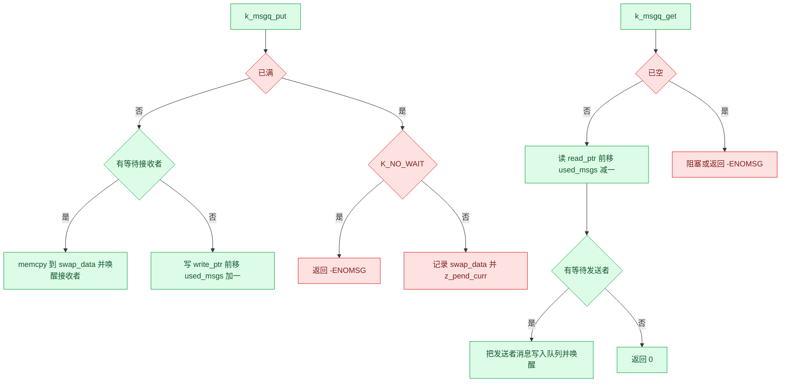

# msgq —— 定长消息队列

> 对应源文件：`kernel/msg_q.c`（共 552 行）
>
> 关联文件：`include/zephyr/kernel.h`（`struct k_msgq`，第 5257 行）、
> `kernel/sched.c`（`z_pend_curr`、`z_unpend_first_thread_locked`）。

一句话职责：**用环形缓冲保存定长消息，队列满/空时让线程在
`wait_q` 上阻塞**；发送/接收在可能时直接 handoff，避免两次拷贝。

---

## 1. 对象结构

`include/zephyr/kernel.h:5257-5290`：

```c
struct k_msgq {
	/** Message queue wait queue */
	_wait_q_t wait_q;
	/** Lock */
	struct k_spinlock lock;
	/** Message size */
	size_t msg_size;
	/** Maximal number of messages */
	uint32_t max_msgs;
	/** Start of message buffer */
	char *buffer_start;
	/** End of message buffer */
	char *buffer_end;
	/** Read pointer */
	char *read_ptr;
	/** Write pointer */
	char *write_ptr;
	/** Number of used messages */
	uint32_t used_msgs;

	Z_DECL_POLL_EVENT

	/** Message queue */
	uint8_t flags;

#ifdef CONFIG_OBJ_CORE_MSGQ
	struct k_obj_core  obj_core;
#endif
};
```

| 字段 | 含义 | 不变量 |
|---|---|---|
| `wait_q` | 阻塞的发送者/接收者 | 读写共用一条队列 |
| `lock` | 保护环形状态 | 所有 put/get 都持它 |
| `msg_size` | 单条消息字节数 | 创建后不变 |
| `max_msgs` | 容量（条） | 创建后不变 |
| `buffer_start` | 缓冲起点 | — |
| `buffer_end` | `buffer_start + max_msgs*msg_size` | — |
| `read_ptr` | 下一条要读的槽 | `buffer_start <= read_ptr < buffer_end` |
| `write_ptr` | 下一个要写的槽 | 同上 |
| `used_msgs` | 当前消息数 | `0 <= used_msgs <= max_msgs` |
| `flags` | 目前只有 `K_MSGQ_FLAG_ALLOC` | 由 `alloc_init` 设置 |

32 位下结构体约 **44 B**；缓冲另算 `msg_size × max_msgs`。

---

## 2. 函数清单

| 函数 | 行号 | 作用 |
|---|---|---|
| `msgq_handle_poll_events` | 37 | 通知 poll 监听者 |
| `k_msgq_init` | 48 | 初始化（用户提供缓冲） |
| `z_impl_k_msgq_alloc_init` | 78 | 从系统堆分配缓冲 |
| `z_msgq_cleanup` | 115 | 释放 `alloc_init` 的缓冲 |
| `k_msgq_cleanup` | 152 | 对外清理入口 |
| `put_msg_in_queue` | 157 | put/put_front 的公共实现 |
| `z_impl_k_msgq_put` | 280 | 尾部入队 |
| `z_impl_k_msgq_put_front` | 285 | 头部入队（不阻塞） |
| `z_impl_k_msgq_get_attrs` | 311 | 查询 msg_size/max/used |
| `z_impl_k_msgq_get` | 329 | 出队 |
| `z_impl_k_msgq_peek` | 426 | 读队首但不移除 |
| `z_impl_k_msgq_peek_at` | 460 | 读第 idx 条 |
| `z_impl_k_msgq_purge` | 506 | 清空并唤醒发送者 |

---

## 3. 逐字摘录

### 3.1 初始化与容量校验

`msg_q.c:48-76`：

```c
void k_msgq_init(struct k_msgq *msgq, char *buffer, size_t msg_size,
		 uint32_t max_msgs)
{
	__ASSERT_NO_MSG(!size_mul_overflow(max_msgs, msg_size, &(size_t){0}));
	__ASSERT_NO_MSG(!size_add_overflow((size_t)(uintptr_t)buffer, max_msgs * msg_size,
					&(size_t){0}));

	msgq->msg_size = msg_size;
	msgq->max_msgs = max_msgs;
	msgq->buffer_start = buffer;
	msgq->buffer_end = buffer + (max_msgs * msg_size);
	msgq->read_ptr = buffer;
	msgq->write_ptr = buffer;
	msgq->used_msgs = 0;
	msgq->flags = 0;
	z_waitq_init(&msgq->wait_q);
	msgq->lock = (struct k_spinlock) {};
#ifdef CONFIG_POLL
	sys_dlist_init(&msgq->poll_events);
#endif	/* CONFIG_POLL */

#ifdef CONFIG_OBJ_CORE_MSGQ
	k_obj_core_init_and_link(K_OBJ_CORE(msgq), &obj_type_msgq);
#endif /* CONFIG_OBJ_CORE_MSGQ */

	SYS_PORT_TRACING_OBJ_INIT(k_msgq, msgq);

	k_object_init(msgq);
}
```

两个 `__ASSERT_NO_MSG` 分别检查：

1. `max_msgs * msg_size` 不溢出；
2. `buffer + max_msgs * msg_size` 不溢出地址空间。

### 3.2 发送的直接 handoff

`msg_q.c:175-239`：

```c
	if (msgq->used_msgs < msgq->max_msgs) {
		/* message queue isn't full. Try to hand the message
		 * directly to the longest-waiting receiver, atomically
		 * under the scheduler's spinlock so a racing in-flight timeout
		 * handler cannot wake the receiver before the message
		 * has been copied into its buffer.
		 */
		LOCK_SCHED_SPINLOCK {
			pending_thread = z_unpend_first_thread_locked(&msgq->wait_q);
			if (pending_thread != NULL) {
				/* copy into the receiver's buffer */
				(void)memcpy(pending_thread->base.swap_data, data,
					     msgq->msg_size);
				arch_thread_return_value_set(pending_thread, 0);
				z_sched_ready_locked(pending_thread);
				resched = true;
			}
		}
		if (pending_thread == NULL) {
			size_t msg_size = msgq->msg_size;
			char *slot;

			__ASSERT_NO_MSG((msgq->write_ptr >= msgq->buffer_start) &&
					(msgq->write_ptr <= (msgq->buffer_end - 1)) &&
					((size_t)(uintptr_t)(msgq->buffer_end - msgq->write_ptr) >=
						msgq->msg_size));
			/*
			 * Pick the slot and update the ring state from
			 * registers first: the compiler cannot tell that the
			 * copy leaves the queue fields alone, so copying last
			 * saves it re-reading them afterwards.
			 */
			if (put_at_back) {
				/*
				 * to write a message to the back of the queue,
				 * take the slot write_ptr points at and
				 * advance write_ptr past it
				 */
				char *next;

				slot = msgq->write_ptr;
				next = slot + msg_size;
				if (next == msgq->buffer_end) {
					next = msgq->buffer_start;
				}
				msgq->write_ptr = next;
			} else {
				/*
				 * to write a message to the head of the queue,
				 * first decrement the read pointer (to open
				 * space at the front of the queue) then copy
				 * the message to the newly created space.
				 */
				slot = msgq->read_ptr;
				if (slot == msgq->buffer_start) {
					slot = msgq->buffer_end;
				}
				slot -= msg_size;
				msgq->read_ptr = slot;
			}
			msgq->used_msgs++;
			(void)memcpy(slot, data, msg_size);
			resched = msgq_handle_poll_events(msgq);
		}
		result = 0;
	} else if (K_TIMEOUT_EQ(timeout, K_NO_WAIT)) {
		/* don't wait for message space to become available */
		result = -ENOMSG;
	} else {
		if (put_at_back) {
			SYS_PORT_TRACING_OBJ_FUNC_BLOCKING(k_msgq, put, msgq, timeout);
		} else {
			SYS_PORT_TRACING_OBJ_FUNC_BLOCKING(k_msgq, put_front, msgq, timeout);
		}

		/* wait for put message success, failure, or timeout */
		_current->base.swap_data = (void *) data;

		result = z_pend_curr(&msgq->lock, key, &msgq->wait_q, timeout);
```

### 3.3 接收与补位

`msg_q.c:342-388`：

```c
	if (likely(msgq->used_msgs > 0U)) {
		size_t msg_size = msgq->msg_size;
		char *slot = msgq->read_ptr;
		char *next = slot + msg_size;

		/* drop the message from the queue, then copy it out */
		if (next == msgq->buffer_end) {
			next = msgq->buffer_start;
		}
		msgq->read_ptr = next;
		msgq->used_msgs--;

		(void)memcpy(data, slot, msg_size);

		/* sanity-check write_ptr in case we hand the slot to a sender */
		__ASSERT_NO_MSG((msgq->write_ptr >= msgq->buffer_start) &&
				(msgq->write_ptr <= (msgq->buffer_end - 1)) &&
				((size_t)(uintptr_t)(msgq->buffer_end - msgq->write_ptr) >=
					msgq->msg_size));

		/* handle first thread waiting to write (if any). Done
		 * atomically under the scheduler's spinlock so we read the
		 * sender's swap_data and complete the wake before any
		 * racing in-flight timeout handler can wake the sender.
		 */
		LOCK_SCHED_SPINLOCK {
			pending_thread = z_unpend_first_thread_locked(&msgq->wait_q);
			if (pending_thread != NULL) {
				SYS_PORT_TRACING_OBJ_FUNC_BLOCKING(k_msgq, get, msgq, timeout);

				/* add the sender's pending message to the queue */
				slot = msgq->write_ptr;
				next = slot + msg_size;
				if (next == msgq->buffer_end) {
					next = msgq->buffer_start;
				}
				msgq->write_ptr = next;
				msgq->used_msgs++;

				(void)memcpy(slot, pending_thread->base.swap_data, msg_size);

				arch_thread_return_value_set(pending_thread, 0);
				z_sched_ready_locked(pending_thread);
				resched = true;
			}
		}
		result = 0;
	} else if (K_TIMEOUT_EQ(timeout, K_NO_WAIT)) {
		/* don't wait for a message to become available */
		result = -ENOMSG;
	} else {
```

### 3.4 清空

`k_msgq_purge()`（`msg_q.c:506-528`）先 `z_sched_wake()` 唤醒所有
等待发送者（返回 `-ENOMSG`），再把 `used_msgs` 置 0、
`read_ptr = write_ptr`。注意它不把两个指针都设回 `buffer_start`，
`write_ptr` 位置保持不变，只是"队列变空"。

---

## 4. 环形缓冲示意


`used_msgs` 是唯一判空/判满依据：

```
空: used_msgs == 0
满: used_msgs == max_msgs
```



---

## 5. 量化

### 5.1 时间与空间

| 操作 | 复杂度 | 说明 |
|---|---|---|
| `k_msgq_put`（无 waiter） | O(1) + memcpy | 一次 `memcpy(msg_size)` |
| `k_msgq_put`（有 waiter） | O(1) + memcpy | 一次 `memcpy`，跳过环形 |
| `k_msgq_get`（有补位） | O(1) + 2×memcpy | 拷出 + 拷入发送者消息 |
| `k_msgq_peek_at(k)` | O(1) + memcpy | 最坏跨回绕，两次 memcpy |
| `k_msgq_purge` | O(w) | w = 等待发送者数 |

`K_MSGQ_DEFINE(q, 32, 16, 4)` 的内存：

```
结构体 44 B + 缓冲 512 B = 556 B（32 位，不含对齐）
```

### 5.2 与 FreeRTOS queue 的对应

| FreeRTOS | Zephyr | 差异 |
|---|---|---|
| `xQueueCreate(len, size)` | `K_MSGQ_DEFINE` | Zephyr 缓冲由用户提供 |
| `xQueueSend` | `k_msgq_put` | 语义几乎一致 |
| `xQueueReceive` | `k_msgq_get` | 语义几乎一致 |
| `xQueueSendToFront` | `k_msgq_put_front` | Zephyr 版本不阻塞 |
| `uxQueueMessagesWaiting` | `k_msgq_num_used_get` | — |
| `xQueueReset` | `k_msgq_purge` | — |

移植 FreeRTOS 代码时，最大的差异是**返回值**：
FreeRTOS 用 `pdTRUE/pdFALSE`，Zephyr 用 `0/-ENOMSG/-EAGAIN`。

---

## 6. 陷阱与读码建议

1. **ISR 里只能 `K_NO_WAIT`**：`msg_q.c:160` 与 `msg_q.c:331` 有
   `__ASSERT(!arch_is_in_isr() || K_TIMEOUT_EQ(timeout, K_NO_WAIT), "")`。
2. **`k_msgq_put_front()` 没有 timeout 参数**，内部固定 `K_NO_WAIT`
   （`msg_q.c:285-288`），队列满直接 `-ENOMSG`。
3. **`msg_size` 必须与实际结构体大小一致**。传 `sizeof(struct)` 而
   不是 `sizeof(pointer)`，否则只拷指针。
4. **读写共用一条 `wait_q`**。`k_msgq_get()` 唤醒的是"队首等待者"，
   它可能是发送者而不是接收者——靠 `swap_data` 的方向约定区分：
   阻塞的接收者 `swap_data` 是目标缓冲，阻塞的发送者是源数据。
5. **`k_msgq_purge()` 只唤醒发送者**（给 `-ENOMSG`），不唤醒接收者。
   接收者会继续等新消息。
6. **缓冲不能是栈上的临时数组**（除非 `k_msgq_init` 后队列生命周期
   不超过该栈帧）。

**读码建议**：先看 `k_msgq_init()` 的指针布局，再看 `put_msg_in_queue()`
的两个分支（handoff / 环形），最后看 `k_msgq_get()` 的补位。
`peek_at()` 的回绕计算是很好的指针算术练习。

---

## 7. 相关条目

- `sched.md`：`z_pend_curr()` 的实现
- `k_heap.md`：`k_msgq_alloc_init()` 的缓冲来源
- Docs：`../../../references/rtos/Zephyr/Docs/04-通信机制.md`
