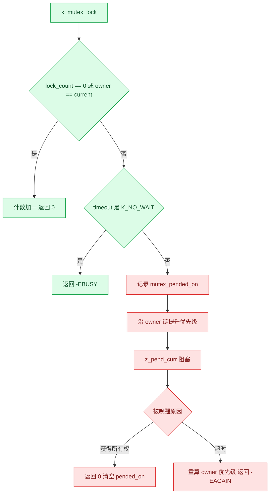

# mutex —— 带优先级继承的互斥量

> 对应源文件：`kernel/mutex.c`（共 497 行）
>
> 关联文件：`include/zephyr/kernel.h`（`struct k_mutex`，第 3500 行）、
> `include/zephyr/kernel/thread.h`（`held_mutexes`、`orig_prio`）、
> `kernel/sched.c`（`z_thread_prio_set`、`z_pend_curr`）。

一句话职责：**在 `k_sem` 之上增加"所有权 + 递归计数 + 优先级继承"**，
把高优先级等待者的优先级沿阻塞链传给持有者，抑制优先级反转。

---

## 1. 对象结构

`include/zephyr/kernel.h:3500-3523`：

```c
struct k_mutex {
	/** Mutex wait queue */
	_wait_q_t wait_q;
	/** Mutex owner */
	struct k_thread *owner;

	/** Current lock count */
	uint32_t lock_count;

#if Z_MUTEX_PI_ENABLED
	/** Node for linking this mutex into the owner thread's held_mutexes list */
	sys_snode_t held_node;
#endif /* Z_MUTEX_PI_ENABLED */

#ifdef CONFIG_OBJ_CORE_MUTEX
	struct k_obj_core obj_core;
#endif
};
```

| 字段 | 含义 | 谁写 |
|---|---|---|
| `wait_q` | 等待者队列，按优先级排序 | `z_pend_curr` |
| `owner` | 当前持有者 | lock/unlock |
| `lock_count` | 递归计数 | lock/unlock |
| `held_node` | 挂到 owner 的 `held_mutexes` 链表 | lock/unlock |

线程侧对应字段（`thread.h:391-407`）：

```c
#if Z_MUTEX_PI_ENABLED
	/**
	 * List of all mutexes currently held by this thread.
	 * Used to recalculate the thread's priority when a mutex is released,
	 * and to propagate priority boosts through the ownership chain.
	 */
	sys_slist_t held_mutexes;

	/**
	 * Mutex this thread is currently blocked on, or NULL if not blocked.
	 * Used for chained priority inheritance (to boost the owner of the
	 * mutex this thread is waiting for) and for deadlock cycle detection.
	 */
	struct k_mutex *mutex_pended_on;
	/** Thread's priority before any mutex inheritance boost. */
	int8_t orig_prio;
#endif /* Z_MUTEX_PI_ENABLED */
```

`Z_MUTEX_PI_ENABLED` 的定义（`thread.h:389`）：

```c
#define Z_MUTEX_PI_ENABLED (CONFIG_PRIORITY_CEILING < CONFIG_NUM_PREEMPT_PRIORITIES)
```

默认 `CONFIG_PRIORITY_CEILING=-128`，`NUM_PREEMPT_PRIORITIES=15`，
所以默认**开启**优先级继承。把 ceiling 设到 ≥15 就整体关闭 PI。

---

## 2. 函数清单

| 函数 | 行号 | 作用 |
|---|---|---|
| `z_impl_k_mutex_init` | 86 | 初始化 owner/count/wait_q |
| `new_prio_for_inheritance` | 125 | 取 target 与 limit 的较高者并夹 ceiling |
| `adjust_owner_prio` | 134 | 改 owner 优先级，返回是否需要重调度 |
| `held_mutexes_highest_waiter_prio` | 152 | 扫描线程持有的所有 mutex，求最高 waiter |
| `z_impl_k_mutex_lock` | 177 | 加锁（快路径/递归/继承/阻塞） |
| `z_impl_k_mutex_unlock` | 386 | 解锁（递归/交接/重算优先级） |
| `z_vrfy_k_mutex_init` | 109 | userspace 校验 |
| `z_vrfy_k_mutex_lock` | 377 | userspace 校验 |
| `z_vrfy_k_mutex_unlock` | 491 | userspace 校验 |

全局锁：

```c
static struct k_spinlock mutex_lock;
```

（`mutex.c:80`）——所有 mutex 共用一把，原因见 `mutex.c:73-79` 的注释。

---

## 3. 逐字摘录

### 3.1 加锁快路径

`mutex.c:177-220`：

```c
int z_impl_k_mutex_lock(struct k_mutex *mutex, k_timeout_t timeout)
{
	k_spinlock_key_t key;
#if Z_MUTEX_PI_ENABLED
	bool resched = false;
#endif

	__ASSERT(!arch_is_in_isr(), "mutexes cannot be used inside ISRs");

	SYS_PORT_TRACING_OBJ_FUNC_ENTER(k_mutex, lock, mutex, timeout);

	key = k_spin_lock(&mutex_lock);

	if (likely((mutex->lock_count == 0U) || (mutex->owner == _current))) {

		mutex->lock_count++;
		mutex->owner = _current;

#if Z_MUTEX_PI_ENABLED
		LOG_DBG("%p took mutex %p, count: %d, orig prio: %d",
			_current, mutex, mutex->lock_count,
			_current->orig_prio);

		/* Add to held list on first acquisition; recursive locks skip this. */
		if (mutex->lock_count == 1U) {
			/* Capture the thread's true pre-inheritance priority
			 * the first time it acquires any mutex.
			 */
			if (sys_slist_is_empty(&_current->held_mutexes)) {
				_current->orig_prio = _current->base.prio;
			}
			sys_slist_append(&_current->held_mutexes, &mutex->held_node);
		}
#else
		LOG_DBG("%p took mutex %p, count: %d",
			_current, mutex, mutex->lock_count);
#endif

		k_spin_unlock(&mutex_lock, key);

		SYS_PORT_TRACING_OBJ_FUNC_EXIT(k_mutex, lock, mutex, timeout, 0);

		return 0;
	}
```

### 3.2 继承链

`mutex.c:232-312`：

```c
#if Z_MUTEX_PI_ENABLED
	/* Record the mutex this thread is blocking on for priority inheritance. */
	_current->mutex_pended_on = mutex;

	/*
	 * Walk the ownership chain, boosting each owner's priority to match
	 * the highest-priority waiter. Detects deadlock cycles along the way.
	 */
	{
		int32_t boost_prio = new_prio_for_inheritance(
					_current->base.prio,
					mutex->owner->base.prio);
		struct k_mutex  *chain_mutex = mutex;
		struct k_thread *chain_owner = mutex->owner;
		int hops = 0;
#if defined(CONFIG_MUTEX_DEADLOCK_DETECT)
		bool all_forever = K_TIMEOUT_EQ(timeout, K_FOREVER);
#endif

		LOG_DBG("chain boosting prio on mutex %p", mutex);

		while (chain_owner != NULL) {
#if defined(CONFIG_MUTEX_DEADLOCK_DETECT)
			/*
			 * Deadlock detection: only when _current and every
			 * chain member visited so far wait forever. all_forever
			 * is updated on every hop, so a finite timeout anywhere
			 * in the chain -- not just at the hop that closes the
			 * cycle -- correctly rules out a false positive.
			 * z_is_thread_pending() guards against a stale
			 * mutex_pended_on in a thread that timed out but has
			 * not yet cleared the field.
			 */
			all_forever = all_forever &&
				      z_is_inactive_timeout(&chain_owner->base.timeout);

			if (all_forever &&
			    chain_owner->mutex_pended_on != NULL &&
			    z_is_thread_pending(chain_owner) &&
			    chain_owner->mutex_pended_on->owner == _current) {
				__ASSERT(false,
					"mutex deadlock: thread %p waiting on "
					"mutex %p (owner %p)",
					_current, mutex, mutex->owner);
				break;
			}
#endif /* CONFIG_MUTEX_DEADLOCK_DETECT */

			if (z_is_prio_higher(boost_prio, chain_owner->base.prio)) {
				resched = adjust_owner_prio(chain_mutex, boost_prio)
					  || resched;
			}

			/*
			 * Stop the chain walk if the owner is not actually
			 * pending — its mutex_pended_on may be stale (e.g. it
			 * just timed out but has not yet cleared the field).
			 * Always boost the current owner first, then decide
			 * whether to continue.
			 */
			if (chain_owner->mutex_pended_on == NULL ||
			    !z_is_thread_pending(chain_owner)) {
				break;
			}

			chain_mutex = chain_owner->mutex_pended_on;
			/*
			 * Cap the walk to prevent spinning on a cycle that
			 * does not pass through the starting mutex.
			 * MUTEX_CHAIN_WALK_MAX_HOPS bounds walk cost under
			 * mutex_lock; it is not a real limit on chain length.
			 * The chain_mutex == mutex check is a fast path for
			 * the common 2-hop cycle through the starting mutex.
			 */
			if (chain_mutex == mutex ||
			    ++hops >= MUTEX_CHAIN_WALK_MAX_HOPS) {
				break;
			}
			chain_owner = chain_mutex->owner;
		}
	}
#endif
```

### 3.3 解锁交接

`mutex.c:429-481`：

```c
#if Z_MUTEX_PI_ENABLED
	/* Remove this mutex from the owner's list of held mutexes */
	sys_slist_find_and_remove(&_current->held_mutexes, &mutex->held_node);

	/*
	 * If the thread's priority was boosted, recalculate it by scanning
	 * the remaining held mutexes. The released mutex has already been
	 * removed from held_mutexes, so it is not included in the scan.
	 */
	if (_current->base.prio != _current->orig_prio) {
		int32_t new_prio = held_mutexes_highest_waiter_prio(
					_current, _current->orig_prio);

		adjust_owner_prio(mutex, new_prio);
	}
#endif

	/* Pick the new owner (if any) and complete the wake atomically
	 * under the scheduler's spinlock, so a racing in-flight timeout
	 * handler cannot observe a half-initialized wake-up.
	 */
	LOCK_SCHED_SPINLOCK {
		new_owner = z_unpend_first_thread_locked(&mutex->wait_q);
		mutex->owner = new_owner;

		LOG_DBG("new owner of mutex %p: %p (prio: %d)",
			mutex, new_owner, new_owner ? new_owner->base.prio : -1000);

		if (unlikely(new_owner != NULL)) {
			/*
			 * new owner is already of higher or equal prio than first
			 * waiter since the wait queue is priority-based: no need to
			 * adjust its priority
			 */
#if Z_MUTEX_PI_ENABLED
			if (sys_slist_is_empty(&new_owner->held_mutexes)) {
				new_owner->orig_prio = new_owner->base.prio;
			}
			sys_slist_append(&new_owner->held_mutexes, &mutex->held_node);
			new_owner->mutex_pended_on = NULL;
#endif
			arch_thread_return_value_set(new_owner, 0);
			z_sched_ready_locked(new_owner);
		} else {
			mutex->lock_count = 0U;
		}
	}

	if (unlikely(new_owner != NULL)) {
		z_reschedule(&mutex_lock, key);
	} else {
		k_spin_unlock(&mutex_lock, key);
	}
```

### 3.4 超时后的降优先级

超时返回 `-EAGAIN` 前，`mutex.c:330-368` 会重新拿 `mutex_lock`：
清空 `_current->mutex_pended_on`，再调
`held_mutexes_highest_waiter_prio()` 重算 owner 的优先级
（只按 owner 仍持有的其他 mutex），最后 `return -EAGAIN`。
降优先级必须延迟到超时线程恢复后做，不能在 timeout ISR 里做，
否则会与 `k_mutex_unlock()` 的锁顺序死锁。

---

## 4. 继承链图




---

## 5. 量化

| 场景 | 开销 |
|---|---|
| 无竞争 lock | 1 次自旋锁 + 2 次写 + 1 次 slist 追加，约 30~50 周期 |
| 递归 lock | 同无竞争，但跳过 slist 追加 |
| 2 级继承（1 跳） | 1 次 `z_thread_prio_set`，约 100~200 周期 |
| N 级继承 | 最多 16 跳，每跳一次 `z_thread_prio_set` |
| unlock 无 waiter | 1 次 slist 删除 + 1 次比较 |
| unlock 有 waiter | 1 次 `z_unpend_first_thread_locked` + 可能 `z_reschedule` |

`MUTEX_CHAIN_WALK_MAX_HOPS = 16`（`mutex.c:123`），
每跳最多一次 `z_thread_prio_set`，所以最坏 `k_mutex_lock`
在持 `mutex_lock` 的情况下执行 16 次优先级变更。

---

## 6. 陷阱与读码建议

1. **不能在 ISR 里用**：`mutex.c:184` 与 `mutex.c:390` 都有 assert。
2. **`k_mutex_lock()` 返回 `-EAGAIN` 表示超时**，不是 `-ETIMEDOUT`。
3. **递归锁必须由同一线程解锁**，否则 `-EPERM`。
4. **优先级继承只在 `CONFIG_PRIORITY_CEILING < NUM_PREEMPT_PRIORITIES`
   时编译**。设 `CONFIG_PRIORITY_CEILING=15` 会静默关闭所有 PI 代码。
5. **继承链最多走 16 跳**，更长的链只提升前 16 个 owner。
6. **超时后的降优先级是延迟的**：由超时线程恢复后自己重算，
   不是 timeout ISR 做。所以 owner 可能短暂处于"过高优先级"。
7. **`orig_prio` 只在 `held_mutexes` 为空时记录**。如果一个线程
   先被其他机制改了优先级（如 `k_thread_priority_set`），
   `orig_prio` 不会自动更新，可能出现"降不回原值"。

**读码建议**：先读 `k_mutex_lock()` 的三个分支，再读
`k_mutex_unlock()` 的交接，最后读继承链的 `while`。
继承链里所有 `break` 条件都对应一个真实并发场景，
可以对照 `mutex.c:34-54` 的 Known limitations 一起看。

---

## 7. 相关条目

- `sched.md`：`z_thread_prio_set()` 的实现
- `thread.md`：`orig_prio`/`held_mutexes` 的初始化
- Docs：`../../../references/rtos/Zephyr/Docs/03-同步原语.md`
