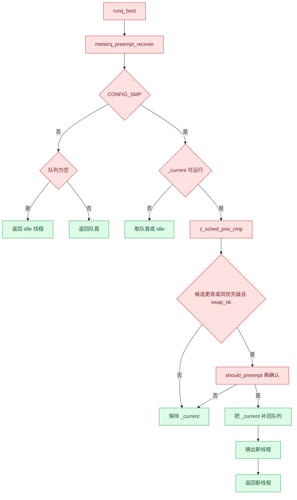

# sched —— 调度器核心

> 对应源文件：`kernel/sched.c`（共 1006 行）
>
> 关联文件：`kernel/include/run_q.h`（108 行）、
> `kernel/include/priority_q.h`（404 行）、
> `include/zephyr/kernel_structs.h`（387 行）、
> `kernel/timeslicing.c`（220 行）。

一句话职责：**维护就绪队列、选出下一个线程、完成上下文切换的通用部分**，
把"具体怎么保存寄存器"留给 `arch_switch()`。

---

## 1. 全局对象

| 对象 | 行号 | 含义 |
|---|---|---|
| `_sched_spinlock` | 48 | 调度器自旋锁，保护就绪队列与线程状态 |
| `_thread_dummy` | 53 | 无有效线程上下文时的替身（ISR 中 abort current） |
| `pending_current` | 45（extern） | `timeslicing.c` 拥有，`SWAP_NONATOMIC` 用 |

`_sched_spinlock` 是**所有**调度状态的唯一锁。`z_ready_thread()`、
`z_unready_thread()`、`z_thread_halt()`、`z_pend_thread()` 都通过
`Z_SCHED_SPINLOCK { ... }` 宏包住临界区。

---

## 2. 函数清单

| 函数 | 行号 | 作用 |
|---|---|---|
| `clear_halting` | 61 | 清除 `_THREAD_ABORTING`/`_THREAD_SUSPENDING` |
| `next_up` | 69 | 选下一个要运行的线程（UP/SMP 两套） |
| `move_current_to_end_of_prio_q` | 172 | yield 时把当前线程移到同优先级队尾 |
| `update_cache` | 179 | 单核缓存"下一个线程"，SMP 只设 `swap_ok` |
| `thread_active_elsewhere` | 211 | 目标线程是否在别的 CPU 上运行 |
| `ready_thread` | 230 | 入队 + 更新缓存 + 发 IPI |
| `z_ready_thread` | 249 | 对外入口，带调度锁 |
| `unready_thread` | 260 | 出队 + 更新缓存 |
| `z_unready_thread` | 273 | 对外入口（benchmark 用） |
| `thread_halt_spin` | 297 | ISR 中等待另一 CPU 上的线程停止 |
| `z_thread_halt` | 319 | suspend/abort 的共享实现 |
| `resched` | 388 | 判断是否满足切换条件 |
| `need_swap` | 401 | 比较 `ready_q.cache` 与 `_current` |
| `reschedule` | 415 | 切换或解锁 |
| `reschedule_locked` | 428 | 已知持调度锁的版本 |
| `z_sched_lock_reschedule` | 433 | 调度锁释放时重调度 |
| `z_sched_yield` | 439 | `k_yield()` 实现 |
| `add_to_waitq_locked` | 449 | 线程入 wait_q 并标记 PENDING |
| `z_sched_add_to_waitq_locked` | 465 | 别名 |
| `pend_locked` | 468 | 入 wait_q + 加 timeout |
| `z_pend_thread` | 478 | 对外入口 |
| `z_unpend_thread_no_timeout` | 487 | 从 wait_q 摘下（不碰 timeout） |
| `z_sched_wake_thread_locked` | 496 | 唤醒线程（已持锁） |
| `z_thread_timeout` | 514 | timeout 到期回调 |
| `z_pend_curr` | 534 | 当前线程阻塞并切换 |
| `z_unpend1_no_timeout` | 567 | 取 wait_q 最高优先级线程 |
| `z_unpend_thread` | 582 | 完整 unpend（含 abort timeout） |
| `z_thread_prio_set` | 599 | 改优先级并维护队列位置 |
| `z_reschedule` | 655 | 别名 |
| `z_reschedule_locked` | 657 | 别名 |
| `z_reschedule_irqlock` | 659 | 只持 IRQ 锁的版本 |
| `z_swap_next_thread` | 674 | 返回下一个线程（不切换） |
| `set_current` | 695 | 带 tracing 的 `_current` 更新 |
| `z_get_next_switch_handle` | 737 | 切换核心：返回新线程的 switch_handle |
| `z_unpend_all` | 814 | 唤醒 wait_q 全部线程 |
| `unpend_all` | 838 | 内部版本（设置返回值） |
| `halt_thread` | 868 | 把线程置为 DEAD/SUSPENDED |
| `z_thread_suspend_current` | 997 | 单核 suspend 当前线程的快速路径 |

---

## 3. 逐字摘录

### 3.1 `next_up()` 单核分支

`sched.c:86-97`：

```c
	struct k_thread *thread = runq_best();

	thread = metairq_preempt_recover(thread);

#ifndef CONFIG_SMP
	/* In uniprocessor mode, we can leave the current thread in
	 * the queue (actually we have to, otherwise the assembly
	 * context switch code for all architectures would be
	 * responsible for putting it back in z_swap and ISR return!),
	 * which makes this choice simple.
	 */
	return (thread != NULL) ? thread : _current_cpu->idle_thread;
#else
```

### 3.2 `next_up()` SMP 分支

`sched.c:110-143`：

```c
	bool queued = z_is_thread_queued(_current);
	bool active = z_is_thread_ready(_current);

	if (thread == NULL) {
		thread = _current_cpu->idle_thread;
	}

	if (active) {
		int32_t cmp = z_sched_prio_cmp(_current, thread);

		/* Ties only switch if state says we yielded */
		if ((cmp > 0) || ((cmp == 0) && !_current_cpu->swap_ok)) {
			thread = _current;
		}

		if (!should_preempt(thread, _current_cpu->swap_ok)) {
			thread = _current;
		}
	}

	if (thread != _current) {
		update_metairq_preempt(thread);
		/*
		 * Put _current back into the queue unless it is ..
		 * 1. not active (i.e., blocked, suspended, dead), or
		 * 2. already queued, or
		 * 3. the idle thread, or
		 * 4. preempted by a MetaIRQ thread
		 */
		if (active && !queued && !z_is_idle_thread_object(_current)
		    && metairq_current_requeue_allowed()) {
			queue_thread(_current);
		}
	}
```

### 3.3 `update_cache()`

`sched.c:179-205`：

```c
static ALWAYS_INLINE void update_cache(int preempt_ok)
{
#ifndef CONFIG_SMP
	struct k_thread *thread = next_up();

	if (should_preempt(thread, preempt_ok)) {
#ifdef CONFIG_TIMESLICING
		if (thread != _current) {
			z_time_slice_reset(thread);
		}
#endif /* CONFIG_TIMESLICING */
		update_metairq_preempt(thread);
		_kernel.ready_q.cache = thread;
	} else {
		_kernel.ready_q.cache = _current;
	}

#else
	/* The way this works is that the CPU record keeps its
	 * "cooperative swapping is OK" flag until the next reschedule
	 * call or context switch.  It doesn't need to be tracked per
	 * thread because if the thread gets preempted for whatever
	 * reason the scheduler will make the same decision anyway.
	 */
	_current_cpu->swap_ok = preempt_ok;
#endif /* CONFIG_SMP */
}
```

### 3.4 切换核心

`sched.c:782-802`（SMP 分支尾部）：

```c
			if (z_is_thread_queued(old_thread)) {
#ifdef CONFIG_SCHED_IPI_CASCADE
				if ((new_thread->base.cpu_mask != -1) &&
				    (old_thread->base.cpu_mask != BIT(cpu_id))) {
					flag_ipi(ipi_mask_create(old_thread));
				}
#endif
				runq_add(old_thread);
			}
		}
		old_thread->switch_handle = interrupted;
		ret = new_thread->switch_handle;
		/* Active threads MUST have a null here */
		new_thread->switch_handle = NULL;

		/* Check for IPIs under the lock to avoid silently consuming a
		 * rescheduling IPI flagged by another CPU for ourselves.
		 */
		signal_pending_ipi();
	}
	return ret;
```

### 3.5 阻塞入口的 ISR 防护

`sched.c:534-565`：

```c
int z_pend_curr(struct k_spinlock *lock, k_spinlock_key_t key,
	       _wait_q_t *wait_q, k_timeout_t timeout)
{
	/* A blocking pend from ISR context is a programming error with no
	 * safe recovery: it would sleep whatever thread was interrupted and,
	 * on CONFIG_SWAP_NONATOMIC, corrupt the scheduler. Refuse it fatally
	 * in every build rather than degrading into the corruption traced in
	 * #111518. Placed first so the refusal performs no side effect.
	 */
	if (arch_is_in_isr()) {
		__ASSERT(false, "blocking pend from ISR context");
		k_panic();
	}

#if defined(CONFIG_TIMESLICING) && defined(CONFIG_SWAP_NONATOMIC)
	pending_current = _current;
#endif /* CONFIG_TIMESLICING && CONFIG_SWAP_NONATOMIC */
	__ASSERT_NO_MSG((sizeof(struct k_spinlock) == 0) || !z_is_sched_spinlock(lock));

	/* We do a "lock swap" prior to calling z_swap(), such that
	 * the caller's lock gets released as desired.  But we ensure
	 * that we hold the scheduler lock and leave local interrupts
	 * masked until we reach the context switch.  z_swap() itself
	 * has similar code; the duplication is because it's a legacy
	 * API that doesn't expect to be called with scheduler lock
	 * held.
	 */
	(void) z_sched_spinlock_lock();
	pend_locked(_current, wait_q, timeout);
	k_spin_release(lock);
	return z_swap_locked(key);
}
```

---

## 4. 调度决策图




---

## 5. 关键机制

### 5.1 单核缓存 vs SMP 实时比较

单核：`_kernel.ready_q.cache` 保存"下次该跑谁"。所有入队/出队/
改优先级操作都调用 `update_cache()` 维护它。`z_swap()` 只需比较
`cache != _current`。

SMP：没有 cache，每次 `next_up()` 都重新比较。`_current` 不在队列里，
所以还要处理"把 current 补回队列"和"从队列摘出新线程"。

### 5.2 `swap_ok` 的语义

`swap_ok` 只存在于 `struct _cpu`（`kernel_structs.h:175-178`）。
它表示"本 CPU 当前是否允许协作式切换"：

- `queue_thread(_current)` 时设为 true（yield）；
- `update_cache(preempt_ok)` 写入调用方语义；
- 切换后清零（`z_get_next_switch_handle` 里 `swap_ok = 0`）。

### 5.3 `halt_thread` 的复杂度

`halt_thread()`（`sched.c:868-995`）要处理：

1. 线程在就绪队列 → 出队；
2. 线程在 wait_q → `unpend`；
3. 线程有 in-flight timeout → 自旋等 `z_try_abort_thread_timeout()`；
4. `_THREAD_DEAD` → 清 join_queue、halt_queue；
5. 如果 abort 的是 ISR 里的 `_current` → `dummify`，把 `_current`
   指向 `_thread_dummy`。

这是 `sched.c` 里最长的函数（128 行），也是并发 bug 最集中的地方。

### 5.4 为什么 `z_unpend_all()` 要无条件 ready

`sched.c:824-830` 的注释：

```c
			/* Abort the timeout and ready the thread unconditionally. If
			 * the timeout handler is in flight on another CPU, the abort
			 * flags it superseded and z_thread_timeout() bails when it
			 * runs -- so it will NOT ready the thread, we must.
			 */
			(void)z_try_abort_thread_timeout(thread);
			ready_thread(thread);
```

这是 4.5 里"timeout superseded"机制的核心：abort 与 handler 竞争时，
由 abort 方负责 ready，handler 看到 superseded 就退出。

---

## 6. 陷阱与读码建议

1. **`z_ready_thread()` 会在目标线程正在别的 CPU 上运行时直接返回**
   （`thread_active_elsewhere()` 非 NULL），只发 IPI。
   调用方不要假设"函数返回后线程一定在队列里"。
2. **`z_sched_lock()` 只影响当前线程**，不是全局锁。
3. **`z_pend_curr()` 会释放调用方的锁**（`k_spin_release(lock)`），
   返回时调用方不再持锁。这一点与 `k_spin_lock` 的直觉相反。
4. **ISR 里调用任何会阻塞的 API 都会 `k_panic()`**
   （`sched.c:543-546`），不是 assert-only。
5. **`update_cache()` 只在单核写 `ready_q.cache`**。
   SMP 下读 `cache` 是无效的（字段根本不存在）。
6. **`z_thread_prio_set()` 对 pending 线程会先摘出 wait_q 再按新优先级
   插回**（`sched.c:635-644`），否则红黑树/有序链表的顺序会被破坏。

**读码建议**：先读 `run_q.h`（108 行）搞清"入队/出队"，
再读 `priority_q.h` 的三种实现，最后回到 `sched.c` 看 `next_up`。
直接读 `sched.c` 会被 meta-IRQ 与 IPI 分支干扰。

---

## 7. 相关条目

- `thread.md`：线程对象与生命周期
- `mutex.md`：`z_thread_prio_set` 的使用者
- `msgq.md`：`z_pend_curr` / `z_unpend_first_thread_locked` 的使用者
- Docs：`../../../references/rtos/Zephyr/Docs/02-线程与调度.md`
