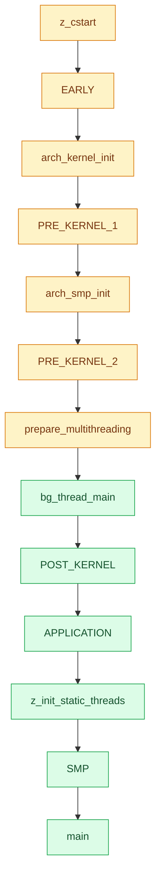
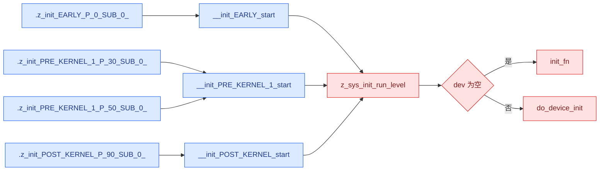

# sys_init —— SYS_INIT 与初始化级别

> 对应源文件：`include/zephyr/init.h`（共 189 行）、
> `kernel/init.c`（共 622 行，执行器部分）
>
> 关联文件：`kernel/Kconfig.device`（初始化优先级默认值）、
> `kernel/device.c`（`do_device_init`）、
> `include/zephyr/linker/common-rom/common-rom-kernel-devices.ld`。

一句话职责：**提供"在 main 之前按 level + priority 执行函数"的
注册机制**，并让设备初始化复用同一条队列。

---

## 1. `struct init_entry`

`init.h:74-85`：

```c
struct init_entry {
	/**
	 * If the init function belongs to a SYS_INIT, this field stored the
	 * initialization function, otherwise it is set to NULL.
	 */
	int (*init_fn)(void);
	/**
	 * If the init entry belongs to a device, this fields stores a
	 * reference to it, otherwise it is set to NULL.
	 */
	const struct device *dev;
};
```

两种形态：

| 形态 | `init_fn` | `dev` | 来源 |
|---|---|---|---|
| SYS_INIT | 函数指针 | NULL | `SYS_INIT` / `SYS_INIT_NAMED` |
| 设备 | NULL | 设备指针 | `DEVICE_DT_DEFINE` / `DEVICE_DEFINE` |

执行器看到 `dev != NULL` 就走 `do_device_init()`，否则直接调用
`init_fn()`。

32 位下每个 entry 8 B（两个指针）。

---

## 2. 六个 level

`init.h:90-103`：

```c
/* Helper definitions to evaluate level equality */
#define Z_INIT_EARLY_EARLY		 1
#define Z_INIT_PRE_KERNEL_1_PRE_KERNEL_1 1
#define Z_INIT_PRE_KERNEL_2_PRE_KERNEL_2 1
#define Z_INIT_POST_KERNEL_POST_KERNEL	 1
#define Z_INIT_APPLICATION_APPLICATION	 1
#define Z_INIT_SMP_SMP			 1

/* Init level ordinals */
#define Z_INIT_ORD_EARLY	0
#define Z_INIT_ORD_PRE_KERNEL_1 1
#define Z_INIT_ORD_PRE_KERNEL_2 2
#define Z_INIT_ORD_POST_KERNEL	3
#define Z_INIT_ORD_APPLICATION	4
#define Z_INIT_ORD_SMP		5
```

| level | 序号 | 执行时机 | 能调内核 API | 典型用途 |
|---|---|---|---|---|
| `EARLY` | 0 | `z_cstart` 最开始 | 否 | arch/SoC 极早期 |
| `PRE_KERNEL_1` | 1 | `arch_kernel_init` 后 | 否 | 时钟、中断控制器 |
| `PRE_KERNEL_2` | 2 | `arch_smp_init` 后 | 否 | pinctrl、GPIO |
| `POST_KERNEL` | 3 | main 线程里 | 是 | 大部分驱动 |
| `APPLICATION` | 4 | main 之前 | 是 | 应用级驱动 |
| `SMP` | 5 | 从核启动后 | 是 | 每 CPU 初始化 |

`init.h:38-51` 的注释是官方定义：

```c
 * - `EARLY`: Used very early in the boot process, right after entering the C
 *   domain (``z_cstart()``). This can be used in architectures and SoCs that
 *   extend or implement architecture code and use drivers or system services
 *   that have to be initialized before the Kernel calls any architecture
 *   specific initialization code.
 * - `PRE_KERNEL_1`: Executed in Kernel's initialization context, which uses
 *   the interrupt stack. At this point Kernel services are not yet available.
 * - `PRE_KERNEL_2`: Same as `PRE_KERNEL_1`.
 * - `POST_KERNEL`: Executed after Kernel is alive. From this point on, Kernel
 *   primitives can be used.
 * - `APPLICATION`: Executed just before application code (`main`).
 * - `SMP`: Only available if @kconfig{CONFIG_SMP} is enabled, specific for
 *   SMP.
```

---

## 3. 注册宏

### 3.1 `SYS_INIT`

`init.h:160-161`：

```c
#define SYS_INIT(init_fn, level, prio)                                         \
	SYS_INIT_NAMED(init_fn, init_fn, level, prio)
```

### 3.2 `SYS_INIT_NAMED`

`init.h:178-181`：

```c
#define SYS_INIT_NAMED(name, init_fn_, level, prio)                                       \
	static const Z_DECL_ALIGN(struct init_entry)                                      \
		Z_INIT_ENTRY_SECTION(level, prio, 0) __used __noasan                      \
		Z_INIT_ENTRY_NAME(name) = {.init_fn = (init_fn_), .dev = NULL}            \
```

展开要点：

- `static const`：每个翻译单元私有，不占全局符号；
- `__used`：防止被链接器 GC；
- `__noasan`：避免 KASAN 对静态 init 记录做插桩；
- `Z_INIT_ENTRY_SECTION(level, prio, 0)`：放到指定 section。

### 3.3 section 名

`init.h:119-121`：

```c
#define Z_INIT_ENTRY_SECTION(level, prio, sub_prio)                                                \
	__attribute__((__section__(                                                                \
		".z_init_" #level "_P_" STRINGIFY(prio) "_SUB_" STRINGIFY(sub_prio)"_")))
```

例：`SYS_INIT(foo, POST_KERNEL, 50)` →
`.z_init_POST_KERNEL_P_50_SUB_0_`。

---

## 4. 执行器

`kernel/init.c:213-243`：

```c
static void z_sys_init_run_level(enum init_level level)
{
	static const struct init_entry *levels[] = {
		__init_EARLY_start,
		__init_PRE_KERNEL_1_start,
		__init_PRE_KERNEL_2_start,
		__init_POST_KERNEL_start,
		__init_APPLICATION_start,
#ifdef CONFIG_SMP
		__init_SMP_start,
#endif /* CONFIG_SMP */
		/* End marker */
		__init_end,
	};
	const struct init_entry *entry;

	for (entry = levels[level]; entry < levels[level+1]; entry++) {
		const struct device *dev = entry->dev;
		int result = 0;

		sys_trace_sys_init_enter(entry, level);
		if (dev != NULL) {
			if ((dev->flags & DEVICE_FLAG_INIT_DEFERRED) == 0U) {
				result = do_device_init(dev);
			}
		} else {
			result = entry->init_fn();
		}
		sys_trace_sys_init_exit(entry, level, result);
	}
}
```

调用点（`init.c`）：

| level | 行号 | 上下文 |
|---|---|---|
| `EARLY` | 547 | `z_cstart` 开头 |
| `PRE_KERNEL_1` | 574 | `arch_kernel_init` 之后 |
| `PRE_KERNEL_2` | 578 | `arch_smp_init` 之后 |
| `POST_KERNEL` | 301 | `bg_thread_main` |
| `APPLICATION` | 316 | `bg_thread_main` |
| `SMP` | 330 | `z_smp_init` 之后 |

链接脚本（`common-rom-kernel-devices.ld:5-21`）：

```ld
	SECTION_PROLOGUE(initlevel,,)
	{
		/*
		 * link in initialization objects for all objects that are
		 * automatically initialized by the kernel; the objects are
		 * sorted in the order they will be initialized (i.e. ordered
		 * by level, sorted by priority within a level)
		 */
		PLACE_SYMBOL_HERE(__init_start);
		CREATE_OBJ_LEVEL(init, EARLY)
		CREATE_OBJ_LEVEL(init, PRE_KERNEL_1)
		CREATE_OBJ_LEVEL(init, PRE_KERNEL_2)
		CREATE_OBJ_LEVEL(init, POST_KERNEL)
		CREATE_OBJ_LEVEL(init, APPLICATION)
		CREATE_OBJ_LEVEL(init, SMP)
		PLACE_SYMBOL_HERE(__init_end);
	} GROUP_ROM_LINK_IN(RAMABLE_REGION, ROMABLE_REGION)
```

---

## 5. 优先级默认值

`kernel/Kconfig.device:48-83`：

| 符号 | 默认值 | 用途 |
|---|---|---|
| `KERNEL_INIT_PRIORITY_OBJECTS` | 30 | 内核对象（堆、slab） |
| `KERNEL_INIT_PRIORITY_LIBC` | 35 | libc |
| `KERNEL_INIT_PRIORITY_DEFAULT` | 40 | 默认 |
| `KERNEL_INIT_PRIORITY_DEVICE` | 50 | 不依赖其他设备的驱动 |
| `APPLICATION_INIT_PRIORITY` | 90 | 应用级驱动 |

`init.h:52` 规定取值 0~999：

```c
 * Initialization priority can take a value in the range of 0 to 999.
```

但**实际不要用满**：section 名按字符串排序，`"100" < "20"`，
跨位数会乱序。推荐只用固定档位或固定宽度（如 `050`）。

---

## 6. 执行顺序图





---

## 7. 内核 pre/post 钩子

除了 level，4.5 还有两个"按需链接"的钩子 section：

| section | 执行点 | 宏 | 用途 |
|---|---|---|---|
| `k_kernel_init_pre_entry` | PRE_KERNEL_1 之前 | `K_KERNEL_INIT_PRE()` | 内核对象就绪后、设备 init 前 |
| `k_kernel_init_post_entry` | POST_KERNEL 之前 | `K_KERNEL_INIT_POST()` | 驱动 init 前 |

`kernel/init.c:564-571`：

```c
	/* Run kernel pre-init hooks before PRE_KERNEL device init, so those
	 * drivers may use the kernel objects initialized here. Entries are
	 * present only for subsystems that are linked in (pay-per-use); the
	 * walk references only the section bounds.
	 */
	STRUCT_SECTION_FOREACH(k_kernel_init_pre_entry, entry) {
		entry->init_fn();
	}
```

与 `SYS_INIT` 的区别：

- 钩子**不占 init_entry**，直接是一个函数指针 section；
- 钩子**没有 level/prio**，只分 pre/post 两档；
- 钩子只在相关子系统被链接进来时才存在（pay-per-use）。

`k_heap` 的 `statics_init` 就刻意**没有**用 pre 钩子，
而是坚持 `PRE_KERNEL_1` 的 `SYS_INIT`，原因见 `kheap.c:43-48`
（KASAN shadow 的注册顺序）。

---

## 8. 陷阱与读码建议

1. **返回值被忽略**。`init.h:148` 明确写 "The return value of the
   initialization function is ignored."。`z_sys_init_run_level()`
   只把 `result` 传给 tracing。
2. **`PRE_KERNEL_*` 不能阻塞**。调度器还没起，
   `z_pend_curr()` 会 `k_panic()`（`sched.c:543-546`）。
3. **prio 必须是字面量或宏**，不能写 `CONFIG_X + 5`
   （`init.h:154-158`）。
4. **同一 prio 的多个 entry 顺序不保证**。链接器按目标文件顺序
   摆放，跨文件顺序取决于链接顺序。
5. **`SYS_INIT` 的 `name` 在同一翻译单元内必须唯一**；
   同一函数注册多次要用 `SYS_INIT_NAMED`。
6. **`EARLY` 级不能用设备**：`Z_DEVICE_CHECK_INIT_LEVEL()`
   只允许 PRE_KERNEL_1/2/POST_KERNEL。

**读码建议**：先读 `init.h` 的 189 行（全是宏，很快），
再看 `z_sys_init_run_level()` 的 30 行，最后对照链接脚本的
`CREATE_OBJ_LEVEL` 理解排序。设备 init 的细节转到 `device.md`。

---

## 9. 相关条目

- `z_cstart.md`：level 的调用点
- `device.md`：`do_device_init`
- Docs：`../../../references/rtos/Zephyr/Docs/01-启动流程与初始化.md`
