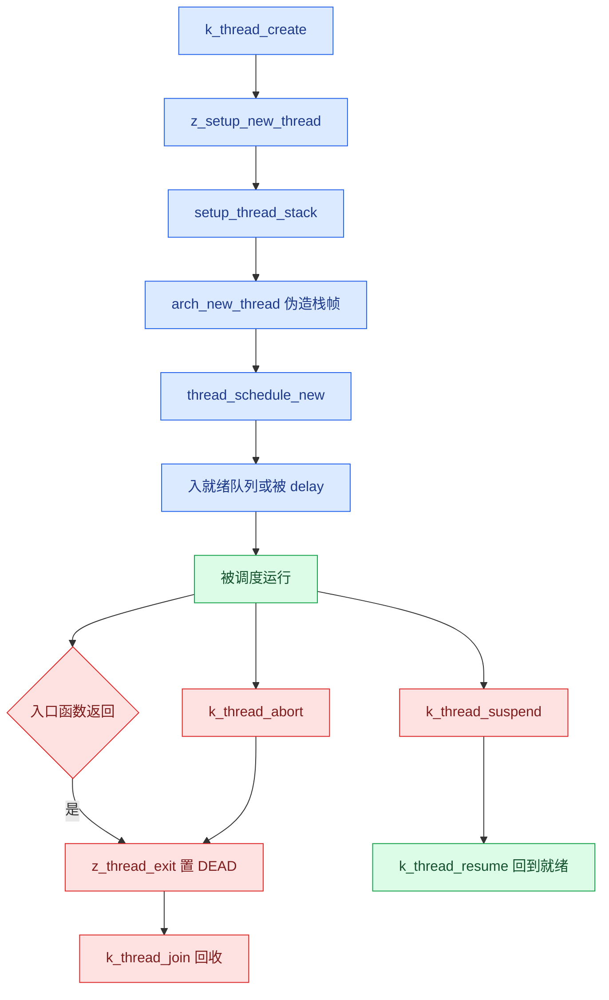

# thread —— 线程生命周期

> 对应源文件：`kernel/thread.c`（共 1924 行）
>
> 关联文件：`include/zephyr/kernel/thread.h`（417 行）、
> `kernel/include/kthread.h`（282 行）、`kernel/include/ksched.h`（316 行）。

一句话职责：**定义 `struct k_thread` 的创建、栈初始化、启动、挂起、
恢复、abort、join 与栈使用量统计**；调度决策不在这里，在 `sched.c`。

---

## 1. 线程对象的关键字段

### 1.1 `struct _thread_base`（`thread.h:46-134`）

| 字段 | 行号 | 含义 |
|---|---|---|
| `qnode_dlist` / `qnode_rb` | 49-52 | 就绪/等待队列节点（union） |
| `pended_on` | 57 | 当前等待的 wait_q |
| `user_options` | 60 | `K_USER`/`K_ESSENTIAL`/`K_INHERIT_PERMS` |
| `prio` + `sched_locked` | 76-87 | 优先级与调度锁，可当 `preempt` 整体比较 |
| `prio_deadline` | 90 | EDF 截止期 |
| `order_key` | 94 | 红黑树 FIFO 序号 |
| `thread_state` | 98 | 8 个状态位 |
| `is_idle`/`cpu`/`global_lock_count` | 100-110 | SMP 字段 |
| `cpu_mask` | 114 | CPU 亲和性 |
| `swap_data` | 118 | 阻塞 API 的传参槽 |
| `timeout` | 122 | 超时节点 |
| `slice_ticks` | 126 | 每线程时间片 |
| `usage` | 132 | 运行时统计 |

### 1.2 `struct k_thread` 的其余部分（`thread.h:258-411`）

| 字段 | 行号 | 含义 |
|---|---|---|
| `callee_saved` | 263 | 架构保存的被调用者寄存器 |
| `init_data` | 266 | 静态线程的 `_static_thread_data` 指针 |
| `join_queue` | 269 | `k_thread_join()` 的等待队列 |
| `futex_pointer` | 276 | 正在等待的 futex 地址 |
| `entry`/`next_thread` | 302-305 | `CONFIG_THREAD_MONITOR` 链表 |
| `name` | 310 | 线程名 |
| `custom_data` | 315 | 应用私有指针 |
| `stack_info` | 331 | 栈边界与 delta |
| `stack_obj`/`syscall_frame` | 344-347 | userspace 用 |
| `switch_handle` | 360 | 架构上下文句柄 |
| `resource_pool` | 363 | 线程级 `k_heap` |
| `held_mutexes`/`mutex_pended_on`/`orig_prio` | 397-406 | 优先级继承 |

---

## 2. 函数清单（按生命周期）

| 阶段 | 函数 | 行号 |
|---|---|---|
| 创建 | `z_setup_new_thread` | 909 |
| 创建 | `z_impl_k_thread_create` | 1032 |
| 创建 | `z_init_thread_base` | 1119 |
| 栈 | `compute_stack_geometry` | 409 |
| 栈 | `map_thread_stack` | 446 |
| 栈 | `setup_thread_stack` | 583 |
| 栈 | `reserve_stack_headroom` | 526 |
| 栈 | `z_stack_space_get` | 1191 |
| 栈 | `k_thread_runtime_stats_get` | 1404 |
| 名称 | `set_thread_name` | 140 |
| 名称 | `z_impl_k_thread_name_set` | 155 |
| 状态 | `k_thread_state_str` | 238 |
| 状态 | `z_check_stack_sentinel` | 345 |
| 生命周期 | `z_impl_k_thread_suspend` | 1689 |
| 生命周期 | `z_impl_k_thread_resume` | 1726 |
| 生命周期 | `z_impl_k_wakeup` | 1755 |
| 生命周期 | `z_thread_abort` | 1780 |
| 生命周期 | `z_impl_k_thread_join` | 1811 |
| 生命周期 | `z_init_thread_base` | 1119 |
| 生命周期 | `k_thread_user_mode_enter` | 1154 |
| 优先级 | `z_impl_k_thread_priority_set` | 1657 |
| 伪线程 | `z_dummy_thread_init` | 1613 |
| 清理 | `defer_thread_cleanup` | 1494 |
| 清理 | `k_thread_abort_cleanup` | 1565 |
| 让步 | `z_impl_k_yield` | 1909 |

---

## 3. 逐字摘录

### 3.1 创建主流程

`thread.c:114-136`（函数中段；前后分别是参数校验、userspace 权限与
tracing）：

```c
	/* Initialize various struct k_thread members */
	z_init_thread_base(&new_thread->base, prio, _THREAD_SLEEPING, options);
	stack_ptr = setup_thread_stack(new_thread, stack, stack_size);

#if Z_MUTEX_PI_ENABLED
	sys_slist_init(&new_thread->held_mutexes);
	new_thread->mutex_pended_on = NULL;
	new_thread->orig_prio = new_thread->base.prio;
#endif /* Z_MUTEX_PI_ENABLED */

	setup_shadow_stack(new_thread, stack);
	assert_thread_coherence(new_thread, stack);

	arch_new_thread(new_thread, stack, stack_ptr, entry, p1, p2, p3);

	/* static threads overwrite it afterwards with real value */
	new_thread->init_data = NULL;

	assert_switch_handle(new_thread);
	init_thread_custom_data(new_thread);
	add_thread_to_monitor(new_thread, entry, p1, p2, p3);
	init_thread_name(new_thread, name);
	init_thread_cpu_mask(new_thread);
```

### 3.2 栈几何

`thread.c:405-439`：

```c
/*
 * Derive the stack object geometry from the caller-supplied stack and size.
 * User-capable stacks and kernel-only stacks reserve different amounts.
 */
static struct stack_geometry compute_stack_geometry(k_thread_stack_t *stack,
						    size_t stack_size)
{
	struct stack_geometry geo;

#ifdef CONFIG_USERSPACE
	if (z_stack_is_user_capable(stack)) {
		geo.obj_size = K_THREAD_STACK_LEN(stack_size);
		geo.buf_start = K_THREAD_STACK_BUFFER(stack);
		geo.buf_size = geo.obj_size - K_THREAD_STACK_RESERVED;
	} else
#endif /* CONFIG_USERSPACE */
	{
		/* Object cannot host a user mode thread */
		geo.obj_size = K_KERNEL_STACK_LEN(stack_size);
		geo.buf_start = K_KERNEL_STACK_BUFFER(stack);
		geo.buf_size = geo.obj_size - K_KERNEL_STACK_RESERVED;

#if defined(ARCH_KERNEL_STACK_RESERVED)
		/* Zephyr treats stack overflow as an app bug.  But
		 * this particular overflow can be seen by static
		 * analysis so needs to be handled somehow.
		 */
		if (K_KERNEL_STACK_RESERVED > geo.obj_size) {
			k_panic();
		}
#endif
	}

	return geo;
}
```

### 3.3 线程创建 API

`thread.c:1032-1046`：

```c
k_tid_t z_impl_k_thread_create(struct k_thread *new_thread,
			      k_thread_stack_t *stack,
			      size_t stack_size, k_thread_entry_t entry,
			      void *p1, void *p2, void *p3,
			      int prio, uint32_t options, k_timeout_t delay)
{
	__ASSERT(!arch_is_in_isr(), "Threads may not be created in ISRs");

	z_setup_new_thread(new_thread, stack, stack_size, entry, p1, p2, p3,
			  prio, options, NULL);

	thread_schedule_new(new_thread, delay);

	return new_thread;
}
```

### 3.4 join

`thread.c:1811-1842`：

```c
int z_impl_k_thread_join(struct k_thread *thread, k_timeout_t timeout)
{
	k_spinlock_key_t key = z_sched_spinlock_lock();
	int ret;

	SYS_PORT_TRACING_OBJ_FUNC_ENTER(k_thread, join, thread, timeout);

	if (z_is_thread_dead(thread)) {
		z_sched_switch_spin(thread);
		ret = 0;
	} else if (K_TIMEOUT_EQ(timeout, K_NO_WAIT)) {
		ret = -EBUSY;
	} else if ((thread == _current) ||
		   (thread->base.pended_on == &_current->join_queue)) {
		ret = -EDEADLK;
	} else {
		__ASSERT(!arch_is_in_isr(), "cannot join in ISR");
		z_sched_add_to_waitq_locked(_current, &thread->join_queue);
		z_add_thread_timeout(_current, timeout);

		SYS_PORT_TRACING_OBJ_FUNC_BLOCKING(k_thread, join, thread, timeout);
		ret = z_swap_locked(key);
		SYS_PORT_TRACING_OBJ_FUNC_EXIT(k_thread, join, thread, timeout, ret);

		return ret;
	}

	SYS_PORT_TRACING_OBJ_FUNC_EXIT(k_thread, join, thread, timeout, ret);

	z_sched_spinlock_unlock(key);
	return ret;
}
```

### 3.5 栈哨兵检查

`thread.c:329-360`：

```c
#ifdef CONFIG_STACK_SENTINEL
/* Check that the stack sentinel is still present
 *
 * The stack sentinel feature writes a magic value to the lowest 4 bytes of
 * the thread's stack when the thread is initialized. This value gets checked
 * in a few places:
 *
 * 1) In k_yield() if the current thread is not swapped out
 * 2) After servicing a non-nested interrupt
 * 3) In z_swap(), check the sentinel in the outgoing thread
 *
 * Item 2 requires support in arch/ code.
 *
 * If the check fails, the thread will be terminated appropriately through
 * the system fatal error handler.
 */
void z_check_stack_sentinel(void)
{
	uint32_t *stack;

	if ((_current->base.thread_state & _THREAD_DUMMY) != 0) {
		return;
	}

	stack = (uint32_t *)_current->stack_info.start;
	if (*stack != STACK_SENTINEL) {
		/* Restore it so further checks don't trigger this same error */
		*stack = STACK_SENTINEL;
		z_except_reason(K_ERR_STACK_CHK_FAIL);
	}
}
#endif /* CONFIG_STACK_SENTINEL */
```

---

## 4. 生命周期图




---

## 5. 关键机制

### 5.1 栈的三段式

`K_THREAD_STACK_DEFINE(name, size)` 分配的对象包含：

```
[ 保留区 ][ 可写缓冲 ][ 对齐填充 ]
```

- `K_THREAD_STACK_RESERVED`：MPU guard、栈哨兵、特权栈等；
- `buf_size = obj_size - reserved`；
- 初始 SP = `buf_start + buf_size - delta`，`delta` 包含 TLS、
  userspace local data、随机偏移。

`reserve_stack_headroom()`（`thread.c:526-552`）负责算 `delta`
并 `ROUND_UP(delta, ARCH_STACK_PTR_ALIGN)`。

### 5.2 `K_ESSENTIAL`

`z_thread_abort()` 检查：

```c
	if (essential) {
		__ASSERT(!essential, "aborted essential thread %p", thread);
		k_panic();
	}
```

（`thread.c:1792-1795`）。`main` 线程与 idle 线程都是 essential；
`bg_thread_main` 在 `main()` 返回后清除 main 的 essential 标记。

### 5.3 `k_thread_join()` 的三种返回值

| 情况 | 返回值 |
|---|---|
| 目标已死 | 0 |
| `K_NO_WAIT` 且目标未死 | `-EBUSY` |
| 自己 join 自己，或形成等待环 | `-EDEADLK` |
| 超时 | `-EAGAIN` |

`-EDEADLK` 的检测只看"目标是否已经等在我的 join_queue 上"，
不做完整环检测。

### 5.4 栈使用量

`z_stack_space_get()`（`thread.c:1191-1240`）从栈底向上数
`0xaa` 字节数（`CONFIG_INIT_STACKS=y` 时栈初始化填 0xaa）。
遇到第一个非 0xaa 就停，所以返回的是"从未被写过的字节数"。

计算示例：1 KB 栈，`z_stack_space_get()` 返回 620，
则历史最高水位 = 1024 - 620 = **404 B**（含哨兵 4 B 与对齐）。

---

## 6. 陷阱与读码建议

1. **线程不能从 ISR 创建**（`thread.c:1038` assert）。
2. **`stack_size` 必须与 `K_THREAD_STACK_SIZEOF()` 一致**。
   传小了会越界，传大了会踩到相邻对象。
3. **`k_thread_join()` 之后才能复用 `struct k_thread`**。
   否则 `z_setup_new_thread()` 的 `assert_thread_not_reused()` 会
   （在 `CONFIG_ASSERT` 下）报错。
4. **`K_THREAD_STACK_DEFINE` 的栈不能放在函数内**（除非 `static`）。
5. **`k_thread_abort()` 对 essential 线程直接 `k_panic()`**，
   没有返回值。
6. **`k_thread_suspend()` 在 SMP 下是异步的**：目标可能还在另一个
   CPU 上跑一小段，函数返回不代表已停。
7. **`CONFIG_THREAD_NAME` 关闭时 `k_thread_name_get()` 返回 NULL**，
   不要直接 `strlen`。

**读码建议**：先看 `z_setup_new_thread()` 的 20 个调用（它就是
"线程对象初始化清单"），再看 `k_thread_create/suspend/resume/abort/join`
五个 API，最后看 `z_init_thread_base()` 与 `z_dummy_thread_init()`。
栈相关函数（`setup_thread_stack` 系列）可以最后看。

---

## 7. 相关条目

- `sched.md`：调度器如何选线程
- `mutex.md`：`orig_prio` 与 `held_mutexes` 的使用
- `z_cstart.md`：main 线程如何被创建
- Docs：`../../../references/rtos/Zephyr/Docs/02-线程与调度.md`
