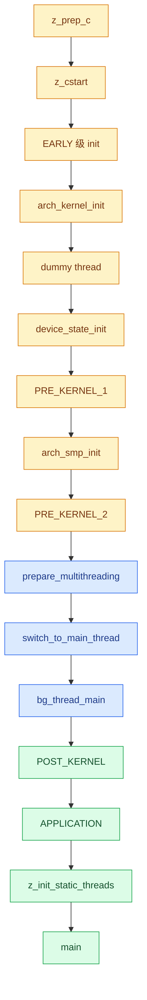
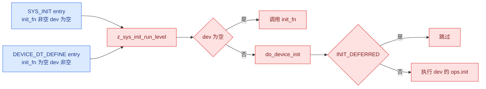

# z_cstart —— 内核启动入口

> 对应源文件：`kernel/init.c`（共 622 行）
>
> 路径说明：Zephyr 4.5 的 `z_cstart()` 位于 `kernel/init.c`，
> 不在 `arch/` 下。各架构的 `arch/*/core/prep_c.c` 只负责清
> `.bss`、拷 `.data`、初始化中断控制器，然后调用 `z_cstart()`。
> 关联文件：`include/zephyr/init.h`（189 行）、
> `arch/arm/core/cortex_m/prep_c.c`（223 行）。

一句话职责：**把"能跑 C 代码"的机器变成"能跑多线程"的内核**，
并在最后切换到 main 线程执行 `bg_thread_main()`。

---

## 1. 全局对象与初始化顺序

### 1.1 本文件定义的全局对象

| 对象 | 行号 | 类型 | 含义 |
|---|---|---|---|
| `_kernel` | 54 | `struct z_kernel` | 全局内核状态唯一实例 |
| `_cpus_active` | 57 | `atomic_t` | PM 使用的活跃 CPU 计数 |
| `z_main_stack` | 61 | `K_THREAD_STACK_DEFINE` | main 线程栈（默认 1024 B） |
| `z_main_thread` | 64 | `struct k_thread` | main 线程对象 |
| `z_idle_threads[]` | 65 | `struct k_thread[]` | 每 CPU 一个 idle 线程 |
| `z_idle_stacks` | 67 | `K_KERNEL_STACK_ARRAY_DEFINE` | idle 栈（默认 256 B/核） |
| `z_interrupt_stacks` | 148 | `K_KERNEL_STACK_ARRAY_DEFINE` | 中断栈，启动期兼作系统栈 |
| `z_sys_post_kernel` | 184 | `bool` | POST_KERNEL 之后置 true |
| `_thread_dummy` | 53（sched.c） | `struct k_thread` | 调度器启动前的假 current |

### 1.2 init level 枚举

`init.c:125-134`：

```c
enum init_level {
	INIT_LEVEL_EARLY = 0,
	INIT_LEVEL_PRE_KERNEL_1,
	INIT_LEVEL_PRE_KERNEL_2,
	INIT_LEVEL_POST_KERNEL,
	INIT_LEVEL_APPLICATION,
#ifdef CONFIG_SMP
	INIT_LEVEL_SMP,
#endif /* CONFIG_SMP */
};
```

序号必须与 `include/zephyr/init.h:97-103` 的 `Z_INIT_ORD_*`
以及链接脚本的 `CREATE_OBJ_LEVEL()` 顺序一致。

---

## 2. 函数清单

| 函数 | 行号 | 作用 | 调用者 |
|---|---|---|---|
| `z_init_static_threads` | 71 | 实例化 `K_THREAD_DEFINE` 的静态线程 | `bg_thread_main` |
| `z_device_state_init` | 195 | 对每个静态 device 做 `k_object_init` | `z_cstart` |
| `z_sys_init_run_level` | 213 | 执行某一 level 的所有 init entry | `z_cstart` / `bg_thread_main` |
| `z_static_init_gnu` | 250 | 执行 `.init_array`（GNU 构造器） | `bg_thread_main` |
| `bg_thread_main` | 272 | main 线程入口，跑完后调 `main()` | 线程入口 |
| `init_idle_thread` | 365 | 构造 idle 线程 | `z_init_cpu` |
| `z_init_cpu` | 395 | 初始化每 CPU 的 idle/中断栈/usage | `prepare_multithreading` / SMP |
| `prepare_multithreading` | 444 | 初始化调度器、建 main 线程 | `z_cstart` |
| `switch_to_main_thread` | 478 | 切到 main 线程 | `z_cstart` |
| `z_early_rand_get` | 497 | 早期随机数（栈保护金丝雀用） | `z_cstart` |
| `z_cstart` | 541 | 内核启动总入口 | `z_prep_c` |

---

## 3. 逐字摘录

### 3.1 `z_cstart()` 主干

`init.c:541-578`（前半段，后半段 593-613 是 `switch_to_main_thread`）：

```c
FUNC_NORETURN void z_cstart(void)
{
	/* gcov hook needed to get the coverage report.*/
	gcov_static_init();

	/* initialize early init calls */
	z_sys_init_run_level(INIT_LEVEL_EARLY);

	/* perform any architecture-specific initialization */
	arch_kernel_init();

	LOG_CORE_INIT();

#if defined(CONFIG_MULTITHREADING)
	z_dummy_thread_init(&_thread_dummy);
#endif /* CONFIG_MULTITHREADING */
	/* do any necessary initialization of static devices */
	z_device_state_init();

	soc_early_init_hook();

	board_early_init_hook();

	/* Run kernel pre-init hooks before PRE_KERNEL device init, so those
	 * drivers may use the kernel objects initialized here. Entries are
	 * present only for subsystems that are linked in (pay-per-use); the
	 * walk references only the section bounds.
	 */
	STRUCT_SECTION_FOREACH(k_kernel_init_pre_entry, entry) {
		entry->init_fn();
	}

	/* perform basic hardware initialization */
	z_sys_init_run_level(INIT_LEVEL_PRE_KERNEL_1);
#if defined(CONFIG_SMP)
	arch_smp_init();
#endif
	z_sys_init_run_level(INIT_LEVEL_PRE_KERNEL_2);
```


### 3.2 init 执行器

`init.c:213-243`：

```c
static void z_sys_init_run_level(enum init_level level)
{
	static const struct init_entry *levels[] = {
		__init_EARLY_start,
		__init_PRE_KERNEL_1_start,
		__init_PRE_KERNEL_2_start,
		__init_POST_KERNEL_start,
		__init_APPLICATION_start,
#ifdef CONFIG_SMP
		__init_SMP_start,
#endif /* CONFIG_SMP */
		/* End marker */
		__init_end,
	};
	const struct init_entry *entry;

	for (entry = levels[level]; entry < levels[level+1]; entry++) {
		const struct device *dev = entry->dev;
		int result = 0;

		sys_trace_sys_init_enter(entry, level);
		if (dev != NULL) {
			if ((dev->flags & DEVICE_FLAG_INIT_DEFERRED) == 0U) {
				result = do_device_init(dev);
			}
		} else {
			result = entry->init_fn();
		}
		sys_trace_sys_init_exit(entry, level, result);
	}
}
```

### 3.3 main 线程入口

`init.c:286-318`（连续原文）：

```c
	z_sys_post_kernel = true;

#if CONFIG_IRQ_OFFLOAD
	arch_irq_offload_init();
#endif

	/* Run kernel post-init hooks before POST_KERNEL device init, so that
	 * drivers initialized there may use them (e.g. submit to the system
	 * work queue). Entries are present only for subsystems that are linked
	 * in (pay-per-use); the walk references only the section bounds.
	 */
	STRUCT_SECTION_FOREACH(k_kernel_init_post_entry, entry) {
		entry->init_fn();
	}

	z_sys_init_run_level(INIT_LEVEL_POST_KERNEL);

	soc_late_init_hook();

	board_late_init_hook();

#if defined(CONFIG_STACK_POINTER_RANDOM) && (CONFIG_STACK_POINTER_RANDOM != 0)
	z_stack_adjust_initialized = 1;
#endif /* CONFIG_STACK_POINTER_RANDOM */

#ifdef CONFIG_STATIC_INIT_GNU
	z_static_init_gnu();
#endif /* CONFIG_STATIC_INIT_GNU */

	/* Final init level before app starts */
	z_sys_init_run_level(INIT_LEVEL_APPLICATION);

	z_init_static_threads();
```

`init.c:324-348`（连续原文）：

```c
#ifdef CONFIG_SMP
	/* Start the secondary CPUs; CPUs whose devicetree node carries
	 * zephyr,deferred-start are skipped and left for a run-time
	 * k_smp_cpu_start()/k_smp_cpu_resume().
	 */
	z_smp_init();
	z_sys_init_run_level(INIT_LEVEL_SMP);
#endif /* CONFIG_SMP */

#ifdef CONFIG_MMU
	z_mem_manage_boot_finish();
#endif /* CONFIG_MMU */

#ifdef CONFIG_BOOTARGS
	extern int main(int argc, char **argv);
	extern char **sys_boot_prepare_main_args(int *argc);

	int argc = 0;
	char **argv = sys_boot_prepare_main_args(&argc);
	(void)main(argc, argv);
#else
	extern int main(void);

	(void)main();
#endif /* CONFIG_BOOTARGS */
```

### 3.4 建 main 线程

`init.c:443-475`：

```c
__boot_func
static char *prepare_multithreading(void)
{
	char *stack_ptr;

	/* _kernel.ready_q is all zeroes */
	z_sched_init();

#ifndef CONFIG_SMP
	/*
	 * prime the cache with the main thread since:
	 *
	 * - the cache can never be NULL
	 * - the main thread will be the one to run first
	 * - no other thread is initialized yet and thus their priority fields
	 *   contain garbage, which would prevent the cache loading algorithm
	 * to work as intended
	 */
	_kernel.ready_q.cache = &z_main_thread;
#endif /* CONFIG_SMP */
	stack_ptr = z_setup_new_thread(&z_main_thread, z_main_stack,
				       K_THREAD_STACK_SIZEOF(z_main_stack),
				       bg_thread_main,
				       NULL, NULL, NULL,
				       CONFIG_MAIN_THREAD_PRIORITY,
				       K_ESSENTIAL, "main");
	z_mark_thread_as_not_sleeping(&z_main_thread);
	z_ready_thread(&z_main_thread);

	z_init_cpu(0);

	return stack_ptr;
}
```

---

## 4. 启动阶段图





---

## 5. 关键设计意图

### 5.1 为什么用中断栈跑初始化

`init.c:140-147` 的注释：

```c
/*
 * storage space for the interrupt stack
 *
 * Note: This area is used as the system stack during kernel initialization,
 * since the kernel hasn't yet set up its own stack areas. The dual purposing
 * of this area is safe since interrupts are disabled until the kernel context
 * switches to the init thread.
 */
```

启动早期没有线程栈可用，但 C 函数需要栈。复用中断栈的理由：

- 中断栈在 `z_cstart` 之前不会被使用（中断还没开）；
- 大小由 `CONFIG_ISR_STACK_SIZE` 保证（默认 2048 B）；
- 切到 main 线程后，中断栈立即恢复"只给 ISR 用"的身份。

### 5.2 为什么 `z_dummy_thread_init` 必须在 PRE_KERNEL_1 之前

`arch_kernel_init()` 之后，`_current_cpu->current` 还是 NULL。
但 `k_spin_lock()`、`z_sched_spinlock_lock()` 里会访问
`_current->base.sched_locked`（SMP 的锁校验）。
`z_dummy_thread_init()`（`thread.c:1613-1647`）把 `_current` 指到
一个 `_THREAD_DUMMY` 状态的静态对象，避免空指针。

### 5.3 `z_init_static_threads` 的双重遍历

`init.c:71-112` 先 `z_setup_new_thread` 建线程，再上调度锁
统一 `thread_schedule_new`。注释解释了为什么：

```c
	/*
	 * Static threads may be started immediately or
	 * after a previously specified delay. Even though the
	 * scheduler is locked, ticks can still be delivered and
	 * processed. Take a sched lock to prevent them from running
	 * until they are all started.
	 */
	k_sched_lock();
```

如果边建边启动，第一个线程可能在第二个线程还没建好时就运行，
破坏"所有静态线程同时可见"的假设。

---

## 6. 陷阱与读码建议

1. **`CONFIG_MAIN_STACK_SIZE` 默认 1024 B**（`kernel/Kconfig:143`）。
   `main()` 里不要放大局部数组。
2. **`z_cstart` 不返回**。`FUNC_NORETURN` + 末尾 `CODE_UNREACHABLE`。
   在它之后写代码没有意义。
3. **`CONFIG_MULTITHREADING=n` 时没有 main 线程**，
   `bg_thread_main` 直接在中断栈上跑；`main()` 返回后死循环。
4. **`SYS_INIT` 返回值被忽略**（`init.h:148`），
   不要指望 `return -EIO` 能阻止启动。
5. **`z_sys_init_run_level` 的 `levels[]` 是 `static const`**，
   放在 ROM 里；`levels[level+1]` 依赖数组末尾的 `__init_end`，
   不能删。
6. **`arch_smp_init()` 在 PRE_KERNEL_1 与 PRE_KERNEL_2 之间**。
   从核的 init 函数如果依赖 PRE_KERNEL_2 的设备，顺序会反。

**读码建议**：先只看 `z_cstart` 的 10 个调用点，把每个 `#ifdef`
当成"可选插件"，第二遍再逐个展开。不要一上来读 `bg_thread_main`
的 90 行 `#ifdef`。

---

## 7. 相关条目

- `sys_init.md`：`SYS_INIT` 宏与 init level 的细节
- `device.md`：`do_device_init` 与设备模型
- `sched.md`：`prepare_multithreading` 之后的调度器
- Docs：`../../../references/rtos/Zephyr/Docs/01-启动流程与初始化.md`
